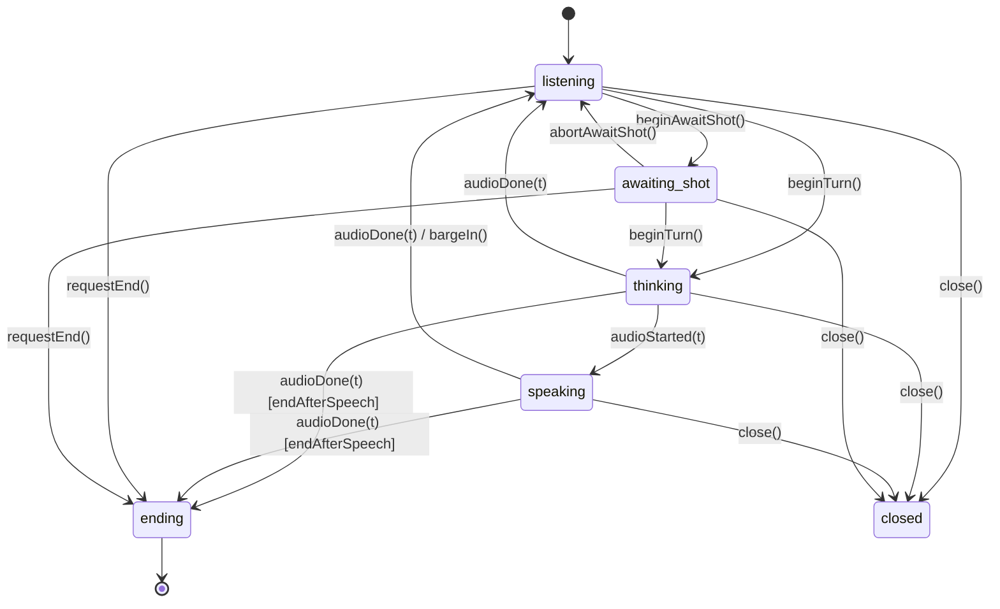
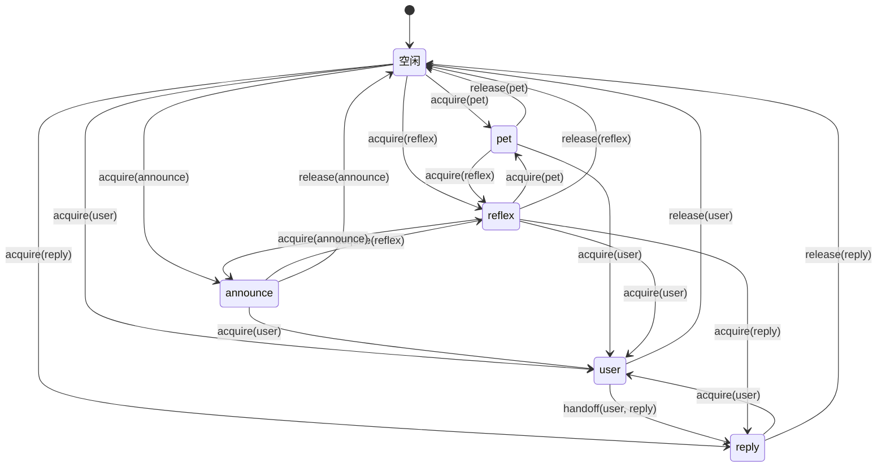
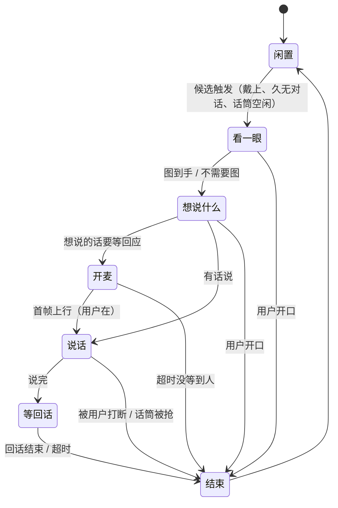
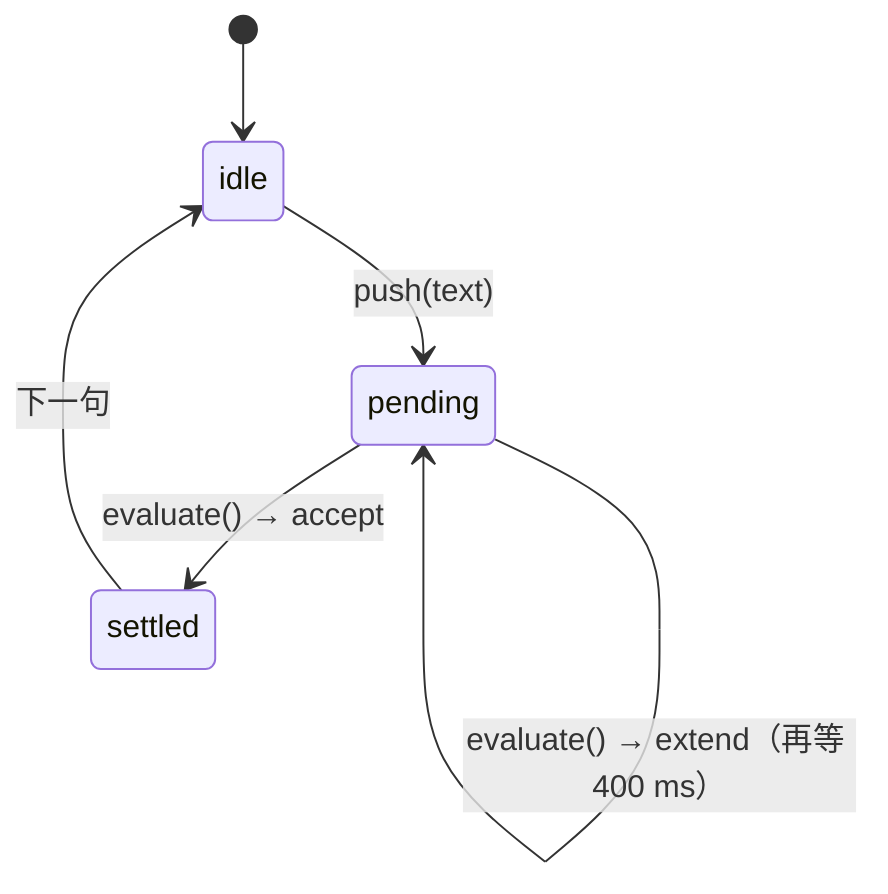
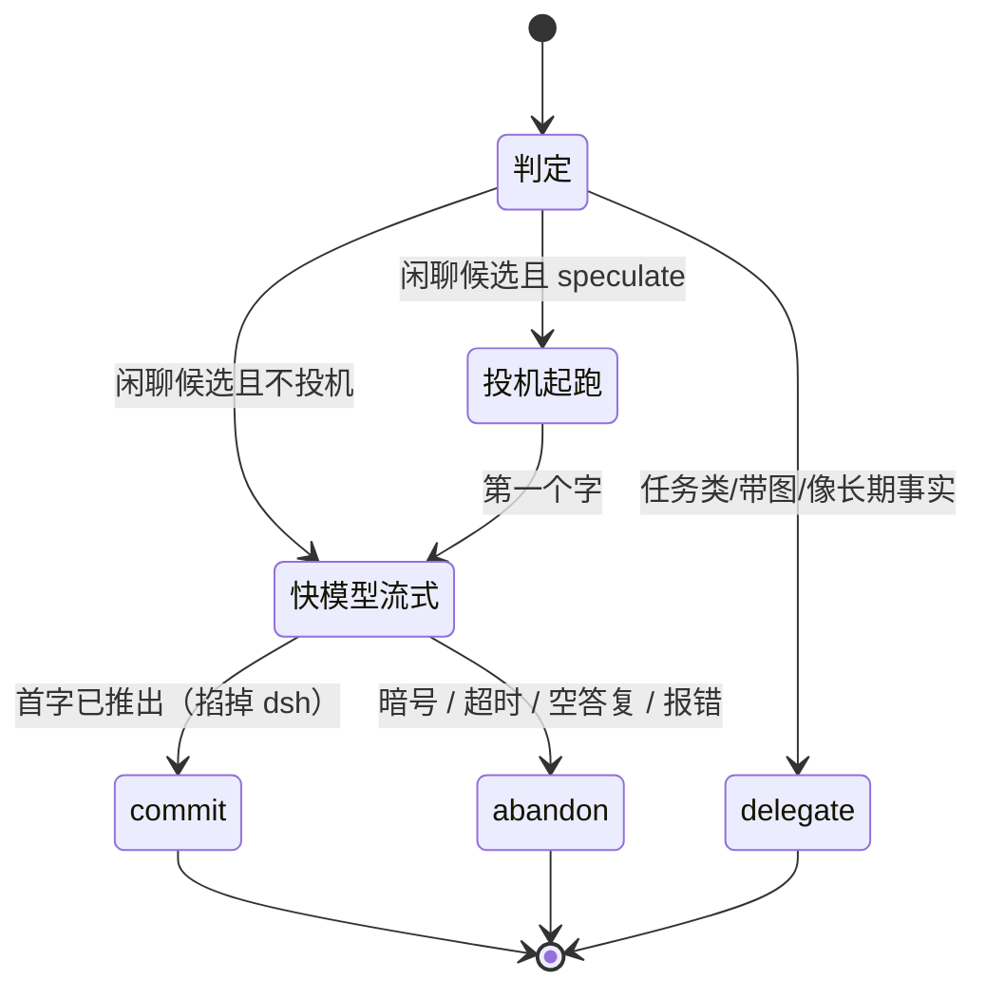
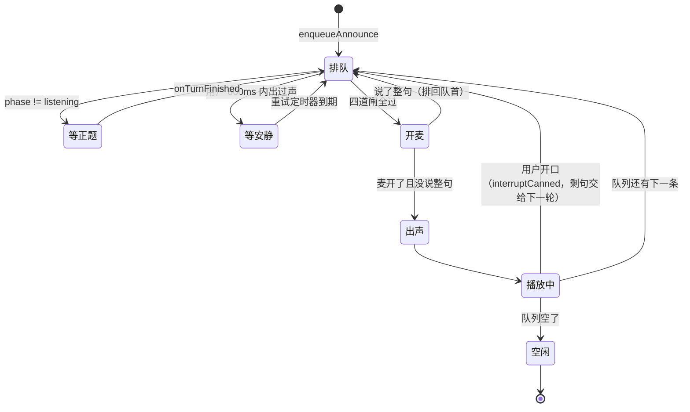
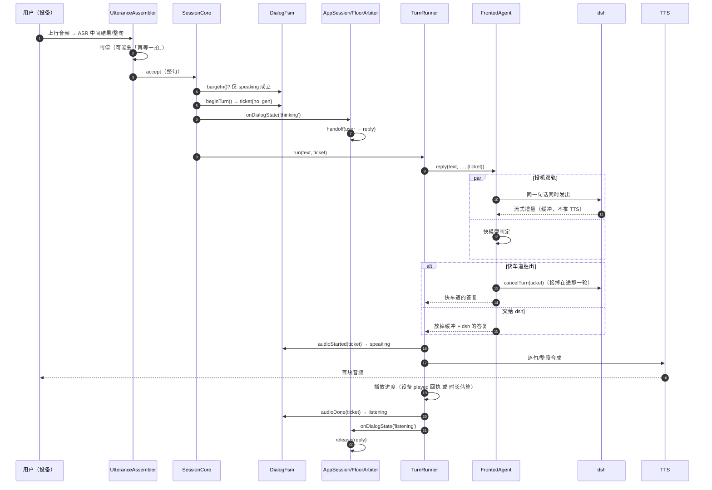
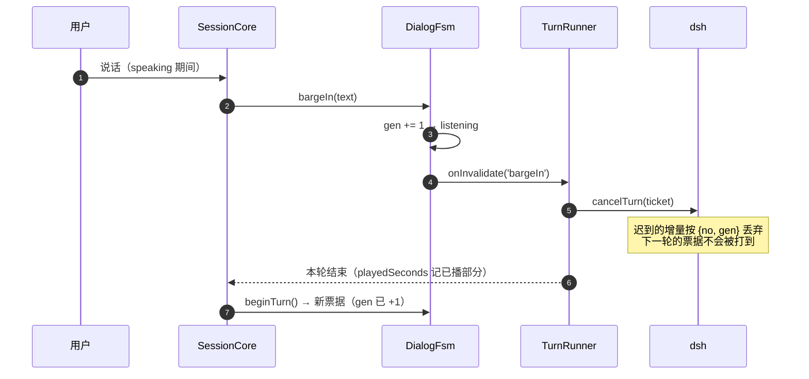
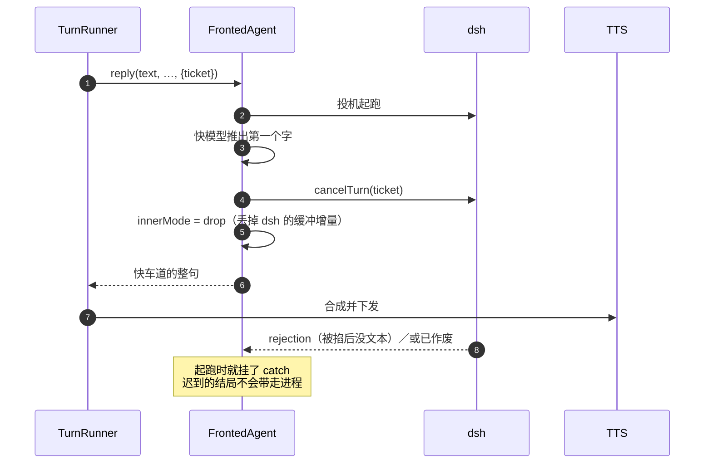

# 状态机一览

以**当前代码**为准（2026-11-17）。旧记录见 [ADR-0001](adr/0001-app-layer-and-pet.md)
与 [ADR-0002](adr/0002-virtual-time-simulator.md)；两者与本文件冲突的地方已在各自文件里
标注取代关系。

这份文档回答四个问题：每台机器有哪些状态、什么事件推动它、转移条件是什么、
**谁持有它、谁驱动它**。最后一节是一条对话从开口到播完的完整时序。

## 0 唯一真相

同一件事只允许有一个模块持有；其他模块通过下面这些入口**读**，不复制。

| 事实 | 唯一持有者 | 读法 |
|---|---|---|
| 话筒归谁 | `AppSession.floor`（`FloorArbiter.owner`） | `floor.busy` / `floor.owner`；宠物经 `PetWorld.floorBusy` 与 `floorTaken` 输入得知 |
| 当前轮次 | `DialogFsm`（`ticket()` → `{no, gen}`） | 上游取消、迟到回调一律拿票据比对（`isStale` / `isCurrent`） |
| 播放进度 | `TurnRunner`（`playedSeen` + 设备 `played` 回执） | 决策「这一轮算说完了吗」只在 `TurnRunner` 内部；`DialogFsm` 只收 `audioDone(ticket)` 这一个结论 |
| 判停中的文本 | `UtteranceAssembler`（`pending`） | 上层只在 `accept` 时拿到整句，拿不到半句 |
| 快车道闸门 | `FrontedAgent.innerMode`（`pass` / `buffer` / `drop`） | dsh 的流式增量按闸门决定直通、缓冲还是丢弃 |
| 委派回执 | `TurnRunner.receipt`（+ `receiptPlaying` / `firstAudioSeen`） | 只在还没出声时能说；答案的第一块一到就置 `cancelled` 并 `audio.stop`，不再有人读它 |
| 宠物状态 | `PetSession.state`（`PetState`） | 纯函数 `brain.step` 产出；执行器无判断 |
| 后台汇报什么时候开口 | `DialogRuntime.announceQueue` + 四道闸 | `queue.length > 0` → 宠物闸门 `floorFree` 不通过（`announcePending`），宠物自己不说话；`announce` 抢不动 `reply` |

> 播放口径：**估算时长是下限，设备回执只能延后**。真机上见过设备在「最后一批字节收到」
> 就报 `played`（4.58 s 音频 1 s 回执），按它收尾会把尾音那段插话窗口关掉。

> 「话筒」这条有三个历史坑，都已经收进 `FloorArbiter`：①`user` 不可抢占，所以
> `userFinal()` 里直接 `claim('reply')` 永远失败，话筒会卡死在 `user`（改用
> `handoff('user','reply')`）；②`AppSession.speaker` 曾是一份影子状态，与仲裁器重复；
> ③`syncFloor()` 曾试图「同步」两者，但它只是恒等式，什么都没做。②③已删除。

### 接线检查清单

「唯一真相」成立的前提是**包装层不吞东西**。2026-11-16 的只读审计抓到三处断点，
当时单测全绿、生产没接上，所以这三条各要有一条按生产装配跑的测试：

| 断点 | 现状 | 测试 |
|---|---|---|
| `beginTurn` / `audioStarted` / `audioDone` 都在 `TurnRunner.run` 里发生，`DialogRuntime.dispatch` 看不到 | `TurnRunnerOptions.onState` 在这三次转移后各回调一次，`DialogRuntime` 接到 `notifyState()` | `tests/wiring-floor-cancel.test.ts` 第一条 |
| `trackActivity` 只在方法存在时透传，内层没有 `cancelTurn` 就整条断面 | `FrontedAgent.cancelTurn` 存在；`trackActivity.reply` 原样透传第四参 `turn` | 同文件第二条 |
| 票据在 `FrontedAgent` 内部换成 `localGen` 就丢了 | `delegate` / `abandon` / `startInner` 都带票据，`inner.reply(..., { ticket })` | 同文件第二条 |

## 1 DialogFsm —— 一轮对话的生命周期

**持有**：`SessionCore.fsm`（`src/session-core.ts` 构造）。
**驱动**：`SessionCore`（ASR 整句、插话、模型要求结束）与 `TurnRunner`
（开轮、首块音频、音频结束）。

### 状态

| 状态 | 含义 |
|---|---|
| `listening` | 话筒在手，等用户说话 |
| `awaiting_shot` | 已答应「拍张高清的」，等图到手再开这一轮 |
| `thinking` | 一轮已开，等上游（dsh / 快车道）出结果 |
| `speaking` | 首块音频已下发，正在播 |
| `ending` | 要收尾了（模型说了再见），本轮播完就关 |
| `closed` | 吸收态：连接已断，任何迟到回调都不得把状态拉回去 |

### 事件与转移

| 事件 | 从 | 到 | 条件 / 副作用 |
|---|---|---|---|
| `beginTurn()` | `listening`、`awaiting_shot` | `thinking` | `no += 1`，发新票据；在 `ending`/`closed` 时返回 `null`，调用方放弃这一轮 |
| `beginAwaitShot()` | `listening` | `awaiting_shot` | 不在 `listening` 时返回 `null` |
| `abortAwaitShot()` | `awaiting_shot` | `listening` | 代次不变 |
| `audioStarted(t)` | `thinking` | `speaking` | 票据过期/不是当前轮则忽略 |
| `audioDone(t)` | `thinking`、`speaking` | `endAfterSpeech ? ending : listening` | 迟到票据按 `{no, gen}` 丢弃 |
| `requestEnd()` | `listening`、`awaiting_shot` | `ending` | 在 `speaking`/`thinking` 只置标志，让告别语播完 |
| `bargeIn(why)` | **仅** `speaking` | `listening` | `gen += 1`（作废排队轮次）→ 通知 `onInvalidate('bargeIn')` |
| `close()` | 任意 | `closed` | 通知 `onInvalidate('closed')` |

票据 `{no, gen}` 是**唯一的轮次令牌**：`no` 每轮 +1，用来丢上一轮迟到的回调；
`gen` 只在插话时 +1，用来作废还排着队的轮次。`onInvalidate` 是**上游取消的唯一触发点**
——`TurnRunner` 订阅它并调 `agent.cancelTurn(ticket)`，所以「插话」「快车道胜出后掐掉慢车道」
「连接结束」走的是同一条取消管道。



## 2 FloorArbiter —— 话筒

**持有**：`AppSession.floor`（`src/app/session.ts`），无论宠物开不开都建。
**驱动**：`TurnRunner.onState`（每轮的三次转移后回调）→ `DialogRuntime.notifyState` →
`AppSession.onDialogState(state)`；`turnStart()`/`turnEnd()` 留给模拟器与直接调用方；
`PetSession` 只管申请，不参与仲裁。

> `notifyState` 有去重（状态没变就不回调），所以**必须**在那三次转移之后各通知一次。
> 只在 `dispatch` 末尾和 `onTurnFinished` 通知时，一轮从头到尾只看到 `listening` 一个状态，
> `release('reply')` 永远不执行 —— 这是审计抓到的 P0-1。

状态就是「谁占着」：`null | user | reply | announce | pet | reflex`。

| 占用者 | 可被谁抢 |
|---|---|
| `user` | 无（用户永远优先） |
| `reply` | `user` |
| `announce` | `user`、敲击（应用层转成 `reflex`/`dismiss`） |
| `pet` | `user`、敲击；`announce` 不抢（等它播完） |
| `reflex` | 任何人 |

| 事件 | 条件 | 结果 |
|---|---|---|
| `acquire(who)` | 空着，或已是同一个人 | 拿到，`true` |
| `acquire(who)` | 按上表可抢 | 换人，`true` |
| `acquire(who)` | 不可抢 | `false`，调用方按 `floorTaken` 处理 |
| `handoff(from, to)` | 当前确实是 `from` | 直接换成 `to`，**不走抢占表** |
| `release(who)` | 当前是 `who` | 清空；不是则 `false` |

`handoff` 存在的唯一理由：`user` 不可抢占，而一轮结束时话筒必须从 `user` 交到 `reply`。
没有它就只能靠影子状态糊过去，那正是被删掉的 `speaker`。

FSM 状态到话筒的映射（`AppSession.onDialogState`）：

| FSM 状态 | 话筒 |
|---|---|
| `thinking` | `reply`（从 `user` 移交） |
| `speaking` | `reply`（整段播放都算应答在说话） |
| `listening` / `ending` / `closed` | 释放 `reply` |
| `awaiting_shot` | 不动（用户随时可以说话，话筒本来就该空着） |



## 3 PetBrain —— 主动开口

**持有**：`PetSession.state`（`PetState`，不可变，`brain.step(state, input)` 换成新值）。
**驱动**：设备事件与定时器经 `PetSession` 归一成 `PetInput`；`PetExecutor` 只执行
状态机产出的命令，不做判断。

`PetState` 四个字段：`world`（时钟、在戴、离场、话筒忙不忙、最近记录）、`engagement`
（当前这次主动开口，`null` = 没在开口）、`fired`（已触发候选的去重键）、`seq`（编号）。

主动开口是一个**阶段子机**：`look`（看一眼）→ `compose`（想说什么）→ `listen`（开麦等首帧）
→ `speak`（说）→ `await`（等回话）。每个阶段都有隐含的 `timeout`，报回结局用 `next`/`end`。

| 层 | 内容 |
|---|---|
| L1 顶层 | 戴上了吗、话筒空不空、够不够久 → 这次要不要开口 |
| L2 阶段子机 | 上面五段，每段登记「什么输入、什么结局」 |
| L3 决断表 | 阶段 × 打断（用户开口、敲击、话筒被占、离场）→ 继续 / 跳过 / 结束 |



## 4 UtteranceAssembler —— 判停

**持有**：`voice-session` 的 `assembler`（`src/utterance-assembler.ts`）。
**驱动**：ASR 中间结果 / 整句（`push`）、预测器（`smart-turn`）、定时器。

| 状态 | 含义 |
|---|---|
| `idle` | 没有待判文本 |
| `pending` | 攒着一段文本，定时器在等（等预测器或等下文） |
| `settled` | 已定稿：整句交给了上层，下一句重新从 `idle` 开始 |

| 事件 | 条件 | 结果 |
|---|---|---|
| `push(text)` | 任意 | 追加到 `pending`，重置定时器 |
| 定时器到期 → `evaluate()` | 预测器说「说完」且不满足「等下文」 | `accept`：整句交给上层 |
| 同上 | 结尾像没说完（数字、井号、连词…）或刚收到中间结果 | `extend`：再等 `extendMs`（默认 400 ms），最多 `maxExtensions` 次 |
| 同上 | 预测器不在 | `predictor-unavailable`：按固定时长兜底 |

「再等一拍」是这里唯一的延迟来源，**与状态机无关**：回放里同一句话的
「② 判停→开轮」在 151 ms 和 625 ms 之间跳，就是这一拍要不要等。



## 5 FrontedAgent 快车道

**持有**：`FrontedAgent.innerMode`（`pass` / `buffer` / `drop`）+ 本地对话窗口。
**驱动**：`TurnRunner` 调 `agent.reply(text, …, {ticket})`；内部先做**本地判据**，再决定
问不问快模型。

| 状态 | 含义 |
|---|---|
| 判定 | 任务类、超长、带图、像长期事实 → 直接 `delegate` 给 dsh，**不问快模型** |
| 投机起跑 | `speculate` 开：dsh 与快模型同时起跑，dsh 的增量先缓冲（`innerMode=buffer`） |
| 快模型流式 | 只看到开头两个字就能判暗号；`[[DELEGATE]]` 判为委派 |
| 胜出 | `commit`：`innerMode=drop`、掐掉在途 dsh（`cancelTurn`）、把这一轮记进窗口 |
| 让路 | `abandon`：放掉缓冲的 dsh 增量（`innerMode=pass`），转用 dsh 的结果 |

| 事件 | 结果 |
|---|---|
| 首字到达 | 立刻掐掉在途 dsh（不为等它整段答完而拖首字） |
| 暗号 `[[DELEGATE]]` 出现 | 一个字都不推给 TTS，转 `abandon` |
| 超时（首字 1200 ms / 整句 2800 ms） | `abandon`，照实报「交给 dsh」 |
| 空答复（清洗后没有可念的文本） | `abandon`，不能哑 |
| 第一句就说完了 | `commit` |



`commit` 之后 dsh 那一轮**一定**要接住 rejection：它被掐时经常以「清洗后没有可朗读的
内容」收场，而 `commit`/`abandon` 挂得比「掐」晚，中间这段窗口里没人接就是进程级未捕获
（线上真挂过一次，见 [fsm-align-report](fsm-align-report.md)）。

**判不出就给回执**：`delegate` / `abandon` 走到 dsh 时，`FrontedAgent` 叫一次
`setDelegateHook(reason)`，`DialogRuntime` 据此让 `TurnRunner.speakReceipt()` 说一句
四字回执（`我看看。` / `嗯，我想想。`）。它**不排 `speechChain`**（排进去本轮 TTS 要等它
播完才开工），答案的第一块一到就置 `cancelled` + `audio.stop`（否则两句叠在一起），
也不进残句缓冲（它不是「用户没听完的内容」）。真机那轮的空白就是这么补的：dsh 轮
`停嘴→首块 2934 ms`，回执在开轮后立刻出声。

## 5.5 播报队列 —— 后台任务的结论什么时候开口

**持有**：`DialogRuntime.announceQueue`（+ `announcing`、`lastUserSpeechAt`、
`lastUserSentenceAt`、单个 `announceRetry` 定时器）。
**驱动**：`agent.setAnnouncer` → `enqueueAnnounce`；`onTurnFinished`；定时器重试。

播报**不属于任何一轮**：走 `speakCanned` 的旁白通道，不占轮次票据、不改状态机。
所以「等它该开口了」这件事只能自己判断，四道闸：

| 闸 | 条件 | 不满足时 |
|---|---|---|
| `disposed` / `announcing` / 队列空 | — | 直接返回 |
| 没有正题在跑 | `core.phase === 'listening'` | 返回，`onTurnFinished` 会再叫一次 |
| 用户真的安静了 | `now - lastUserSpeechAt ≥ 800 ms` | `scheduleAnnounceRetry(800 - quietFor)`，**只排一个** |
| 开麦窗口没被打断 | `lastUserSentenceAt ≤ mark`（开麦前记的时刻） | 排回**队首**，等下一轮 |

第三条用 `lastUserSpeechAt`（连 partial 也算）是因为用户说话时 FSM 也是 `listening`
（要等整句定稿才进 `thinking`），光看状态会在换气口插进去。第四条只看**整句**：
开麦最长 1.5 s，而且用户已经在说时麦是立刻开的 —— 最该让路的时候反而最快开口；
但一个语气词的 partial 不值得把汇报再推后一轮。

已经念到一半被打断：旁白期间 FSM 停在 `listening`，`bargeIn` 对它不成立，所以只有
`dispatch` 里那一次 `interruptCanned()`（非旁听句子才触发）。没念完的部分切成残句，
下一轮作为系统注记交给模型自己判断补不补。**一个字都没发出去时不算残句** ——
否则下一轮会把用户从没听过的整条汇报塞进回答里。



## 5.8 怎么验证状态轮转真的对

上面每节写的「转移条件」，代码里对不对不能靠读 —— 跑一场，看档案：

```bash
node --experimental-strip-types scripts/fsm-trace-check.ts <档案目录 | events.jsonl>
```

审计器在 [`src/fsm-trace.ts`](../src/fsm-trace.ts)，判据全部来自本文件与代码里的既有事实：

| 规则 | 违反时的意思 |
|---|---|
| `turn.nested` / `turn.orphanEnd` / `turn.unclosed` | 串行队列漏了，或者某轮被丢下 |
| `state.whitelist` | 有人绕过 `transition` 改状态，或转移表被改动 |
| `state.afterClose` | `closed` 之后还有活的东西在跑 |
| `state.audioBeforeSpeaking` | 先出声后进 `speaking`（插话窗口会错位） |
| `state.turnCovered` | 一轮里没见过 `thinking`/`speaking`（通知链断了，就是 P0-1 那类） |
| `state.settledAfterTurn` | 一轮结束后没落回 `listening`/`ending` |
| `barge.noAudioStop` | 被判插话却没发 `audio.stop`（喇叭停不下来） |
| `turn.tooLong` / `timing.stopToFirst` | 挂住，或者用户等太久 |

状态事件来自 `dialog.state`（`DialogRuntime.notifyState` 落档）。**老档案没有这个事件**时，
状态那几条记「缺仪表」跳过 —— 与 `latency-report` 的 `null` 口径一致，不拿「没记录」冒充「没问题」。

## 6 一轮对话的完整时序



### 分支 A：用户插话



### 分支 B：快车道胜出


