# 状态机一览

以**当前代码**为准（2026-11-17）。旧记录见 [ADR-0001](adr/0001-app-layer-and-pet.md)
与 [ADR-0002](adr/0002-virtual-time-simulator.md)；两者与本文件冲突的地方已在各自文件里
标注取代关系。

这份文档回答四个问题：每台机器有哪些状态、什么事件推动它、转移条件是什么、
**谁持有它、谁驱动它**。最后一节是一条对话从开口到播完的完整时序。

## 0 唯一真相

同一件事只允许有一个模块持有；其他模块通过下面这些入口**读**，不复制。

| 事实 | 唯一持有者 | 读法 |
|---|---|---|
| 话筒归谁 | `AppSession.floor`（`FloorArbiter.owner`） | `floor.busy` / `floor.owner`；宠物经 `PetWorld.floorBusy` 与 `floorTaken` 输入得知 |
| 当前轮次 | `DialogFsm`（`ticket()` → `{no, gen}`） | 上游取消、迟到回调一律拿票据比对（`isStale` / `isCurrent`） |
| 播放进度 | `TurnRunner`（`playedSeen` + 设备 `played` 回执） | 决策「这一轮算说完了吗」只在 `TurnRunner` 内部；`DialogFsm` 只收 `audioDone(ticket)` 这一个结论 |
| 判停中的文本 | `UtteranceAssembler`（`pending`） | 上层只在 `accept` 时拿到整句，拿不到半句 |
| 快车道闸门 | `FrontedAgent.innerMode`（`pass` / `buffer` / `drop`） | dsh 的流式增量按闸门决定直通、缓冲还是丢弃 |
| 委派回执 | `TurnRunner.receipt`（+ `receiptPlaying` / `firstAudioSeen`） | 只在还没出声时能说；答案的第一块一到就置 `cancelled` 并 `audio.stop`，不再有人读它。**出声期间它占着 `DialogFsm` 的 `speaking`**（`receiptStarted` / `receiptEnded`），所以那会儿用户开口算插话 |
| 宠物状态 | `PetSession.state`（`PetState`） | 纯函数 `brain.step` 产出；执行器无判断 |
| 后台汇报什么时候开口 | `DialogRuntime.announceQueue` + 四道闸 | `queue.length > 0` → 宠物闸门 `floorFree` 不通过（`announcePending`），宠物自己不说话；`announce` 抢不动 `reply` |
| omni 车道状态 | `VoiceConnection.omni`（`OmniShadow.state`：`idle`/`connecting`/`ready`/`busy`/`broken`） | `FrontedAgent.audioLane.willServe()` / `explain()`；宿主只经这两个入口读，不复制状态 |
| 这一轮由谁答 | `FrontedAgent`（`willServeAudio()` 与 `reply()` 内部**同一套判据**：`lane.willServe()` + `textEligible()`） | `TurnRunner` 只按 `reply.audio !== undefined` 分支，不自己判 |
| omni 那一份音频归谁 | `OmniShadow.claimedResp`（认领时绑定） | `AgentAudioAnswer.chunks` / `transcript()` 的闭包；**不许事后去 `resp` 里找**（见 §5.6） |

> 播放口径：**估算时长是下限，设备回执只能延后**。真机上见过设备在「最后一批字节收到」
> 就报 `played`（4.58 s 音频 1 s 回执），按它收尾会把尾音那段插话窗口关掉。

> 「话筒」这条有三个历史坑，都已经收进 `FloorArbiter`：①`user` 不可抢占，所以
> `userFinal()` 里直接 `claim('reply')` 永远失败，话筒会卡死在 `user`（改用
> `handoff('user','reply')`）；②`AppSession.speaker` 曾是一份影子状态，与仲裁器重复；
> ③`syncFloor()` 曾试图「同步」两者，但它只是恒等式，什么都没做。②③已删除。

### 接线检查清单

「唯一真相」成立的前提是**包装层不吞东西**。2026-11-16 的只读审计抓到三处断点，
当时单测全绿、生产没接上，所以这三条各要有一条按生产装配跑的测试：

| 断点 | 现状 | 测试 |
|---|---|---|
| `beginTurn` / `audioStarted` / `audioDone` 都在 `TurnRunner.run` 里发生，`DialogRuntime.dispatch` 看不到 | `TurnRunnerOptions.onState` 在这三次转移后各回调一次，`DialogRuntime` 接到 `notifyState()` | `tests/wiring-floor-cancel.test.ts` 第一条 |
| `trackActivity` 只在方法存在时透传，内层没有 `cancelTurn` 就整条断面 | `FrontedAgent.cancelTurn` 存在；`trackActivity.reply` 原样透传第四参 `turn` | 同文件第二条 |
| 票据在 `FrontedAgent` 内部换成 `localGen` 就丢了 | `delegate` / `abandon` / `startInner` 都带票据，`inner.reply(..., { ticket })` | 同文件第二条 |

## 1 DialogFsm —— 一轮对话的生命周期

**持有**：`SessionCore.fsm`（`src/session-core.ts` 构造）。
**驱动**：`SessionCore`（ASR 整句、插话、模型要求结束）与 `TurnRunner`
（开轮、首块音频、音频结束）。

### 状态

| 状态 | 含义 |
|---|---|
| `listening` | 话筒在手，等用户说话 |
| `awaiting_shot` | 已答应「拍张高清的」，等图到手再开这一轮 |
| `thinking` | 一轮已开，等上游（dsh / 快车道）出结果 |
| `speaking` | **有声音在播**。可能是答案的首块音频，也可能只是委派轮的回执（靠 `_receiptOnly` 区分） |
| `ending` | 要收尾了（模型说了再见），本轮播完就关 |
| `closed` | 吸收态：连接已断，任何迟到回调都不得把状态拉回去 |

> `speaking` 的含义是「**用户这会儿听得见东西**」，不是「答案开始了」。委派轮那句回执
> （「我看看。」）也占这个状态 —— 判据是**有没有声音**，不是「有没有在等模型」，否则
> 用户听完回执说「不用了」会被当成同一句的下文合并，而不是插话。

### 事件与转移

| 事件 | 从 | 到 | 条件 / 副作用 |
|---|---|---|---|
| `beginTurn()` | `listening`、`awaiting_shot`、**`thinking`** | `thinking` | `no += 1`，发新票据；在 `ending`/`closed` 时返回 `null`，调用方放弃这一轮 |
| | | | **`thinking` 是合法前驱**：用户在模型还在跑的时候又说了一句 → 新票据让旧票过期，旧轮的结果被 `isStale` 丢弃。**这就是「出声前吸收窗口」的实现方式**，真机上一半的句中停顿都走这条路。以前这里记成「⚠ 调度 bug」（注释写着「串行队列保证不会到这里」），是**错的** —— 按注释去「修」它，等于取消吸收窗口 |
| `beginAwaitShot()` | `listening` | `awaiting_shot` | 不在 `listening` 时返回 `null` |
| `abortAwaitShot()` | `awaiting_shot` | `listening` | 代次不变 |
| **`receiptStarted()`** | `thinking` | `speaking` | 置 `_receiptOnly`；不在 `thinking` 时返回 `false`（这一轮已被作废/已收尾，不该出声） |
| **`receiptEnded()`** | `speaking`（且 `_receiptOnly`） | `thinking` | 幂等；不动代次。回执被真音频顶掉后调用它是空操作 |
| `audioStarted(t)` | `thinking` | `speaking` | 票据过期/不是当前轮则忽略；**清 `_receiptOnly`**（真音频接管）。**触发点是首块音频要下发的那一刻**（`turn-runner` 的 `emit()` 里，紧挨着 `sendAudio`），不是回复文本到达时 |
| `audioDone(t)` | `thinking`、`speaking` | `endAfterSpeech ? ending : listening` | 迟到票据按 `{no, gen}` 丢弃；`_receiptOnly` 为真时**直接返回**（回执那段 `speaking` 不是本轮音频） |
| `requestEnd()` | `listening`、`awaiting_shot` | `ending` | 在 `speaking`/`thinking` 只置标志，让告别语播完 |
| `bargeIn(why)` | **仅** `speaking`（含回执那段） | `listening` | `gen += 1`（作废排队轮次）→ 清 `_receiptOnly` → 通知 `onInvalidate('bargeIn')` |
| `close()` | 任意 | `closed` | 通知 `onInvalidate('closed')` |

票据 `{no, gen}` 是**唯一的轮次令牌**：`no` 每轮 +1，用来丢上一轮迟到的回调；
`gen` 只在插话时 +1，用来作废还排着队的轮次。`onInvalidate` 是**上游取消的唯一触发点**
——`TurnRunner` 订阅它并调 `agent.cancelTurn(ticket)`，所以「插话」「快车道胜出后掐掉慢车道」
「连接结束」走的是同一条取消管道。

### 出声前的吸收窗口 = `thinking → thinking`

用户说完一句、模型还在跑（`thinking`），这期间他**又开口**，实际发生的是：

1. ASR 定稿 → `SessionCore.dispatch` 的 `utterance` 分支 —— 它**不检查当前相位**
2. `fsm.beginTurn()` → `no += 1` → 新票据，`thinking → thinking`
3. 旧票过期 → 旧轮上游的取消走 `onInvalidate` 那条管道（`agent.cancelTurn(ticket)`）
4. 旧轮的结果回来时 `isStale(ticket)` 为真 → **一个字都不下发**；
   快车道也不会走 `commit` → **不写进对话历史**

效果等价于「合并后重答」，但**实现是新轮取代旧轮**，不是把两段文本拼起来。

**为什么这条值得单列**：它就是「延迟越低、越容易被句中停顿切开」的那个吸收窗口本身，
却长期只在一句话里被提到，既没进事件表也没进审计。`beginTurn()` 里那句
「串行队列保证不会到这里」的注释曾经把这条正常路径记成调度 bug —— 按它去「修」，
等于取消吸收窗口。

**还没做的审计**（`fsm-trace`）：被取代的轮次（票 `no` 小于当前轮、且没有 `turn.end`）
不得出现 `tts.first` 或下行音频。真机上「半句当整句答」如果还在发生，先查这里。

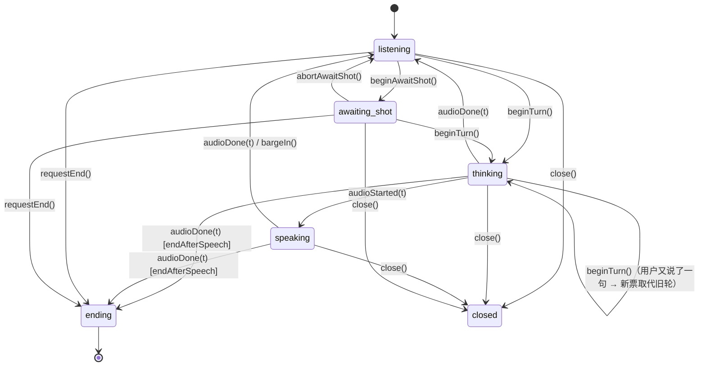

## 2 FloorArbiter —— 话筒

**持有**：`AppSession.floor`（`src/app/session.ts`），无论宠物开不开都建。
**驱动**：`TurnRunner.onState`（每轮的三次转移后回调）→ `DialogRuntime.notifyState` →
`AppSession.onDialogState(state)`；`turnStart()`/`turnEnd()` 留给模拟器与直接调用方；
`PetSession` 只管申请，不参与仲裁。

> `notifyState` 有去重（状态没变就不回调），所以**必须**在那三次转移之后各通知一次。
> 只在 `dispatch` 末尾和 `onTurnFinished` 通知时，一轮从头到尾只看到 `listening` 一个状态，
> `release('reply')` 永远不执行 —— 这是审计抓到的 P0-1。

状态就是「谁占着」：`null | user | reply | announce | pet | reflex`。

| 占用者 | 可被谁抢 |
|---|---|
| `user` | 无（用户永远优先） |
| `reply` | `user` |
| `announce` | `user`、敲击（应用层转成 `reflex`/`dismiss`） |
| `pet` | `user`、敲击；`announce` 不抢（等它播完） |
| `reflex` | 任何人 |

| 事件 | 条件 | 结果 |
|---|---|---|
| `acquire(who)` | 空着，或已是同一个人 | 拿到，`true` |
| `acquire(who)` | 按上表可抢 | 换人，`true` |
| `acquire(who)` | 不可抢 | `false`，调用方按 `floorTaken` 处理 |
| `handoff(from, to)` | 当前确实是 `from` | 直接换成 `to`，**不走抢占表** |
| `release(who)` | 当前是 `who` | 清空；不是则 `false` |

`handoff` 存在的唯一理由：`user` 不可抢占，而一轮结束时话筒必须从 `user` 交到 `reply`。
没有它就只能靠影子状态糊过去，那正是被删掉的 `speaker`。

FSM 状态到话筒的映射（`AppSession.onDialogState`）：

| FSM 状态 | 话筒 |
|---|---|
| `thinking` | `reply`（从 `user` 移交） |
| `speaking` | `reply`（整段播放都算应答在说话） |
| `listening` / `ending` / `closed` | 释放 `reply` |
| `awaiting_shot` | 不动（用户随时可以说话，话筒本来就该空着） |

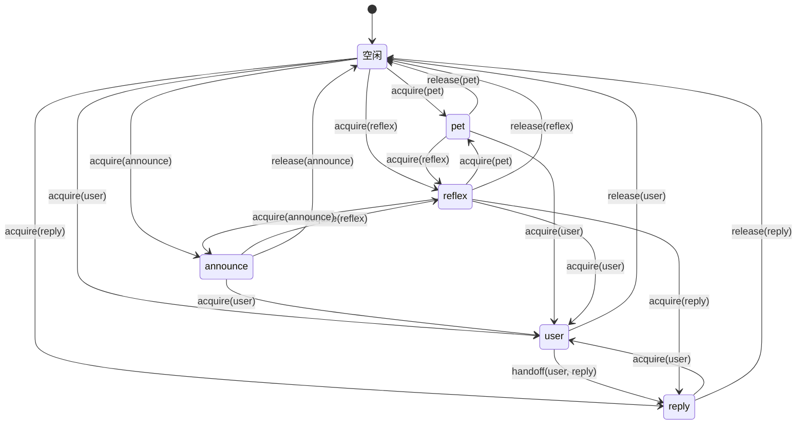

## 3 PetBrain —— 主动开口

**持有**：`PetSession.state`（`PetState`，不可变，`brain.step(state, input)` 换成新值）。
**驱动**：设备事件与定时器经 `PetSession` 归一成 `PetInput`；`PetExecutor` 只执行
状态机产出的命令，不做判断。

`PetState` 四个字段：`world`（时钟、在戴、离场、话筒忙不忙、最近记录）、`engagement`
（当前这次主动开口，`null` = 没在开口）、`fired`（已触发候选的去重键）、`seq`（编号）。

主动开口是一个**阶段子机**：`look`（看一眼）→ `compose`（想说什么）→ `listen`（开麦等首帧）
→ `speak`（说）→ `await`（等回话）。每个阶段都有隐含的 `timeout`，报回结局用 `next`/`end`。

| 层 | 内容 |
|---|---|
| L1 顶层 | 戴上了吗、话筒空不空、够不够久 → 这次要不要开口 |
| L2 阶段子机 | 上面五段，每段登记「什么输入、什么结局」 |
| L3 决断表 | 阶段 × 打断（用户开口、敲击、话筒被占、离场）→ 继续 / 跳过 / 结束 |

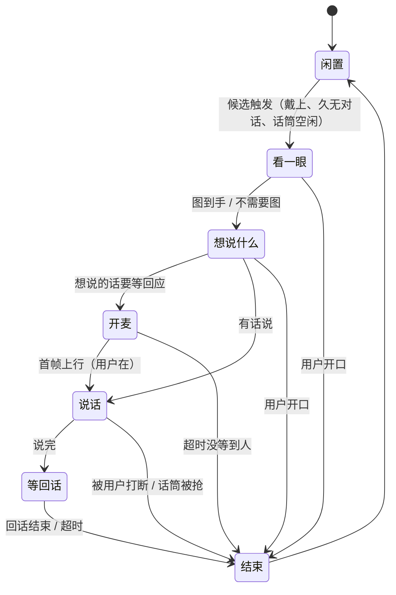

## 4 UtteranceAssembler —— 判停

**持有**：`voice-session` 的 `assembler`（`src/utterance-assembler.ts`）。
**驱动**：ASR 中间结果 / 整句（`push`）、预测器（`turn-judge`）、定时器。

| 状态 | 含义 |
|---|---|
| `idle` | 没有待判文本 |
| `pending` | 攒着一段文本，定时器在等（等预测器或等下文） |
| `settled` | 已定稿：整句交给了上层，下一句重新从 `idle` 开始 |

| 事件 | 条件 | 结果 |
|---|---|---|
| `push(text)` | 任意 | 追加到 `pending`，重置定时器 |
| `notePartial(text)` | 任意 | 只更新 `lastPartialText`（不拼文本，中间结果会反复改写）。**静音满 `speculateMs`（100 ms）时**用它给快车道投机，见 §5 |
| 定时器到期 → `evaluate()` | 预测器说「说完」且不满足「等下文」 | `accept`：整句交给上层 |
| 同上 | 结尾像没说完（数字、井号、连词…）或刚收到中间结果 | `extend`：再等 `extendMs`（默认 400 ms），最多 `maxExtensions` 次 |
| 同上 | 预测器不在 | `predictor-unavailable`：按固定时长兜底 |

**两个新增的门（2026-11-18，只在「端点由我们控」的 ASR 上生效）**：

| 门 | 何时 | 做什么 |
|---|---|---|
| `commitAfterMs`（`VOICE_COMMIT_MS`，代码默认 40 / **线上 20**） | 上行静音到点、且这段有音频 | 让 ASR 封段开始解码（`SttSession.commit()`），一段只封一次。**omni 也在这里起跑**（同一行 `omni.seal()`，见 §5.6） |
| `openQuietMs` / `openQuietShortMs`（`VOICE_OPEN_QUIET_MS`，300 / 200；p ≥ 0.8 走短档） | 定稿到达时 | 要求「**截至此刻**」的连续静音 ≥ 门槛才允许 `accept`；不够就 `extend` 差额（`why=silence`）。防的是「换气被当成句尾」 |

> **短档不是死代码**（2026-11-19 核对四份真机档案，69 次判停）：静音门整体只触发 5 次（7%），
> 其中短档 2 次 —— `080409` 的 `p=0.981 / 静音 196ms / 实等 4ms`、`094025` 的
> `p=0.823 / 静音 137ms / 实等 63ms`。**这两次都靠 200 而不是 300 才只等了 4 / 63 ms**，
> 删掉短档会让它们各多等 100 ms。触发率低是真的，「从不生效」不成立。

配套的**静音去抖**：单帧（20 ms）有声不算重新开口，连续两帧才算 —— 这段录音里 20 ms 的
「有声」有 14 处，多是塞音闭塞段，不去抖会让静音计时反复归零、开轮门槛永远不成立。

**QoS：`②` 的等待预算（2026-11-18）**

| 旋钮 | 线上值 | 作用 |
|---|---:|---|
| `waitBudgetMs`（`TURN_JUDGE_WAIT_BUDGET_MS`） | 400 | 这一轮为等判停**最多**花多少毫秒，用完就收下。取代「分支额度 × 每拍」那种随分支数量漂移的上限（真机 7/29 轮把额度吃干净，单轮白等 1.4 s） |
| `waitBudgetSequenceMs`（`TURN_JUDGE_SEQUENCE_BUDGET_MS`） | 1200 | 句尾像**未完成的序列**（数字 / 字母 / 「然后」…）时给**更大的预算**：这类句尾 p 判「没说完」**是对的**，别被总预算掐掉（真机一句手机号被拆成 3–4 轮）。判据复用 `looksUnfinished()`，纯机械。**只换预算，不换拍数**（原来是 12 倍拍数豁免，一个正则压过所有数值限额 —— 已删） |
| `maxOpenSilenceMs`（`TURN_JUDGE_MAX_OPEN_SILENCE_MS`） | 650 | **统一上限**：开轮时连续静音的天花板。放在所有分支之前，谁都不能绕过 —— 原来静音闸门在预算判断之前 `return`，实测把 ② 顶到 2264 ms。到顶就放行并落 `whyAccept:'cap'` |

`grace`（刚收到中间结果就再等一拍）和 `unfinished`（结尾像没说完的文本正则）已在
`ed87bc7` 删除：真机 2 场 87 次 extend 里命中 0/8 与 0/3，白等 3950 ms。
现在**只有三条**会加拍：静音闸门、短碎片、`p` 说没说完。其余情况一律收下。

落档同时加了三个字段：`silenceMs`（此刻连续静音）、`waitedMs`（这轮已等多久）、
`budgetMs`（这轮的预算）—— 以后要按真实分布做自适应标定，数据先攒着。

「再等一拍」是这里主要的延迟来源，**与状态机无关**：回放里同一句话的
「② 判停→开轮」在 151 ms 和 625 ms 之间跳，就是这一拍要不要等。
（开轮门槛例外：定稿本身就晚于停嘴 ~260 ms，多数轮次它不花时间。）

**这 400 ms 和投机的命中率是同一枚硬币**：判停愿意等满预算的轮次，投机更容易命中
（`agent 段 0–15 ms`）；判停立即收的轮次，投机要么来不及、要么靠 `prefetch` 提前量。
**但这不是硬地板** —— 真正的浪费是「投机已经跑起来又被并段重起」那个 bug
（已修 `830768d`，见 §5），以及「提前量够不够」，两者都与 400 ms 这个数字无关。
实测账见 §5 的「投机什么时候起跑」。

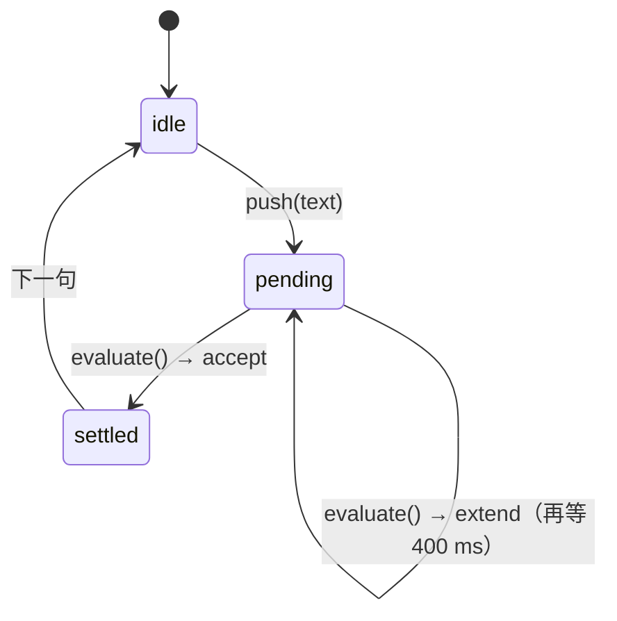

## 5 FrontedAgent 快车道

**持有**：`FrontedAgent.innerMode`（`pass` / `buffer` / `drop`）+ 本地对话窗口。
**驱动**：`TurnRunner` 调 `agent.reply(text, …, {ticket})`；内部先做**形态判据**，再决定
问不问快模型。

> 判据只挡形态，**不判语义**（2026-11-19 起）：空、超 `FAST_LANE_MAX_CHARS`、含阿拉伯数字。
> 语义上该不该转交由模型在流里输出 `[[DELEGATE]]` 决定 —— 本地词表判过一版，
> 「你看过星球大战没？」「为什么？」因为含「看」「为什么」被一票判成任务，真机 92 轮里 25 轮白走 dsh。

| 状态 | 含义 |
|---|---|
| 判定 | 超长、带图、像长期事实、上句 dsh 在等回话 → 直接 `delegate` 给 dsh，**不问快模型** |
| 投机起跑 | `speculate` 开：dsh 与快模型同时起跑，dsh 的增量先缓冲（`innerMode=buffer`） |
| 快模型流式 | 只看到开头两个字就能判暗号；`[[DELEGATE]]` 判为委派 |
| 胜出 | `commit`：`innerMode=drop`、掐掉在途 dsh（`cancelTurn`）、把这一轮记进窗口 |
| 让路 | `abandon`：放掉缓冲的 dsh 增量（`innerMode=pass`），转用 dsh 的结果 |

| 事件 | 结果 |
|---|---|
| 首字到达 | 立刻掐掉在途 dsh（不为等它整段答完而拖首字） |
| 暗号 `[[DELEGATE]]` 出现 | 一个字都不推给 TTS，转 `abandon` |
| 超时（首字 1200 ms / 整句 2800 ms） | `abandon`，照实报「交给 dsh」 |
| 空答复（清洗后没有可念的文本） | `abandon`，不能哑 |
| 第一句就说完了 | `commit` |

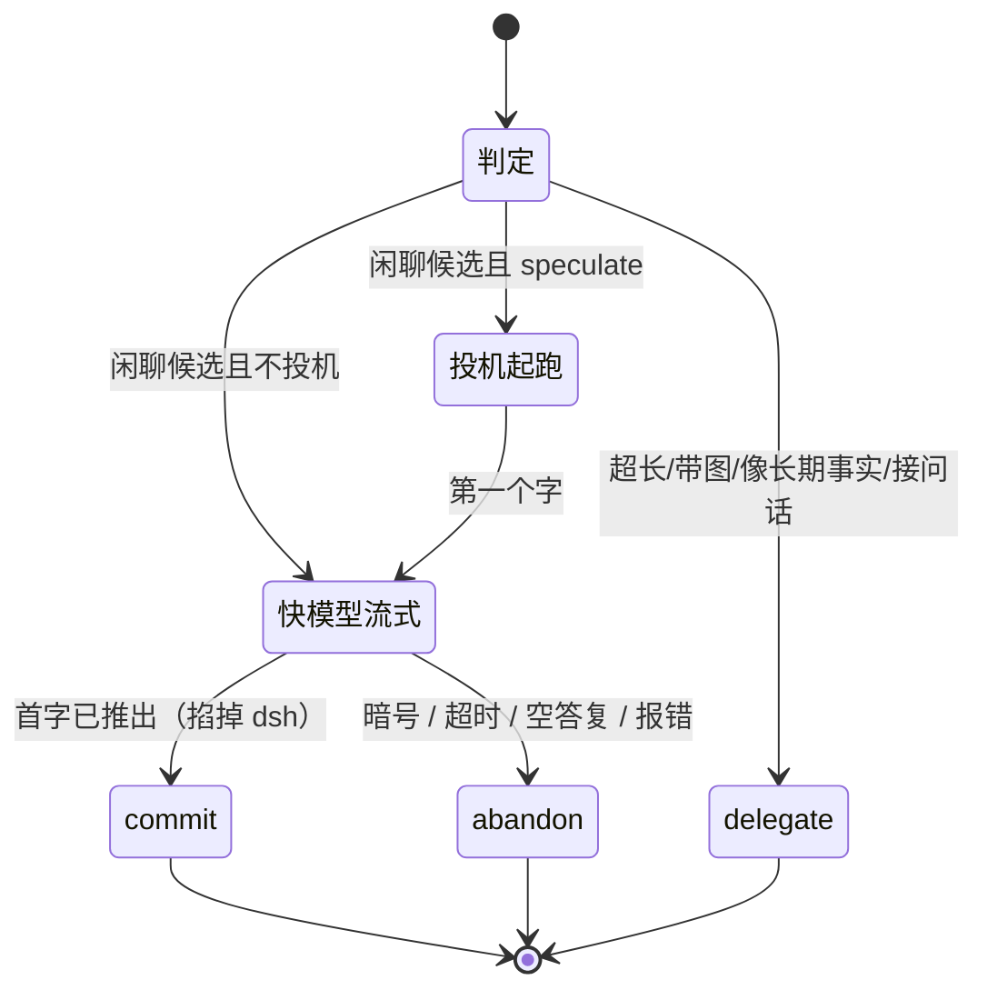

`commit` 之后 dsh 那一轮**一定**要接住 rejection：它被掐时经常以「清洗后没有可朗读的
内容」收场，而 `commit`/`abandon` 挂得比「掐」晚，中间这段窗口里没人接就是进程级未捕获
（线上真挂过一次，见 [fsm-align-report](fsm-align-report.md)）。

### 投机什么时候起跑（**别改成「中间结果一到就发」**）

投机由 `UtteranceAssembler.maybeSpeculate` 在**静音满 100 ms**（`VOICE_SPECULATE_MS`）
时触发，用手里已有的 `lastPartialText` 发出去。四条防呆各对应一次真机踩坑：

| 防呆 | 踩过的坑 |
|---|---|
| 这一版 partial 必须属于本段语音（`lastPartialAt > lastUtteranceAt`） | `lastPartialText` 不会跟着语音结束自动清空，上一段最后那版「嗯」被拿去猜下一句 |
| **接收方说发出去了才算一次**（`onPartial` 返回 `boolean`） | 门槛在 `FrontedAgent`、记账在组装器：一句被挡掉的「嗯」把整段语音的机会用光了（`071340` 轮 2/3/11） |
| 同一版 partial 只问一次（`specTriedText`） | 静音帧 20 ms 一个，不去重会每个 tick 刷一遍 |
| 真发出去了就不再问（`lastVoicedAt > specFiredAt`） | 后来补的 partial 重起跑，等于把已经跑掉的作废（`080409` 轮 11 认领时只剩 2 ms） |

每句最多 2 次（`specCount`，`addSentence` 归零）。

**「重试」是前两条的直接后果**（2026-11-19）：静音 100 ms 那一刻 partial 若还不够，
下一个静音 tick 会再问 —— 但只在 partial 变了的时候。三场真机算下来，「有投机」的
轮次从 2/11、5/14、3/17 提到 6/11、9/14、10/17，**但新增的提前量只有 14–30 ms**
（原来那些是 247–261 ms）。所以它改的是覆盖率，不改 p50。

### partial 到底到得有多晚（2026-11-19 实测，`scripts/partial-timeline.py`）

三场 52 轮。**每一档用同一把尺**：去全部标点后的覆盖率，不带字数门槛（原来把
「`acceptsSpeculation`（含 `minChars=6`）」和「覆盖 ≥90%」并列，才会出现
「更严的门槛达标更多」的假矛盾）。

| 判据 | 提前量中位 | p90 | max |
|---|---|---|---|
| 覆盖 ≥60% | 175–472 | 561–751 | 883 |
| 覆盖 ≥90% | 18–22 | 19–423 | 567 |
| 完全一致 | **16** | 19–313 | 423 |

**真正的问题不是「中位低」，是「60% 与 90% 之间隔着 600–750 ms」**：ASR 按语义段吐
partial，段与段之间一个字都不吐（`071340` 轮 4 从 −764 ms 到 −22 ms 有 742 ms 空档），
最后一段紧贴定稿。于是「可认领的 partial」分两类：

- **安全类**：段尾那版已经接近完整（`071340` 轮 1 在 −319 ms 就 90%），认领零风险；
- **陷阱类**：段中那版只有 60–70%，缺的正是**宾语**（`080409` 轮 4 缺「蓝母吗」、
  轮 5 缺「佛拉尼斯」），模型只能反问。

**线上判据已经收紧成「去标点后完全一致」**（`acceptsSpeculation`），陷阱类不再会被
认下来。代价是丢掉一类语义安全但不逐字一致的情形（「…是什么？」对「…是什么来着？」）。
收益几乎不损失：完全一致的提前量中位 16 ms，52 轮里还有 8 轮能白赚 300–423 ms。

**短句（≤6 字）单独看**：停嘴 +100 ms 时 19 轮里只有 3 轮接近完整，90% 覆盖的提前量
中位 12–16 ms —— 降门槛救不了，因为 partial 本身没到。例外是「partial 已等于定稿、
但 `asr.sentence` 还在等静音确认」那一类（`071340` 轮 6/10 各省 313/320 ms）。

**配额是硬约束**：带句末标点即发 + 完全一致认领时，每句 2 次 → 命中 25%，
3 次 → 62%，5 次 → 94%，但**中位提前量始终 6–8 ms**。所以配额保持 2。

认领时投机缺了哪几个字，现在落进 `agent.spec`（`spec` / `final` / `missing`），
事后能查「答非所问」是不是投机认下来的。

2026-11-19 试过两条改法并**全部 revert**，但**这两组数不能直接归因到触发时机**：

| 线上代码 | fast p50 | 档案 |
|---|---|---|
| 静音 100 ms（现状） | **1032** | `20261119-071340`，8 轮 |
| `notePartial` 一到就发（`1272bc1`） | 1176 | `20261119-080409`，11 轮 |
| 再加「说话中变长重来」（`bbf15ae`） | 1172 | `20261119-081608`，8 轮 |

后两场走「等满判停预算」的轮次更多（各 3 轮 ②=476），而那些轮次本来就是 1111–1172 ——
1176 / 1172 更像「那两场判停等得更多」，不是「更早投机有害」。

**逐轮审计查出来的真问题是**：投机已经跑起来之后，ASR 又补一版更长的 partial，
`speculatePartial` 判成「越改越长」→ `startPrefetch` 里 `dropPrefetch` + 重发。
`20261119-080409` 轮 11 的投机提前 **1370 ms**、文本与定稿一字不差，仍被重起，
开轮时那趟只跑了 **2 ms**。

已修（`830768d`）：变长时若旧文本覆盖新文本 ≥ `SPEC_MIN_COVERAGE`（认领用的就是这把尺），
**沿用**，且不消耗每句 2 次的配额。

「发出去的被自己扔了」确实存在且已修（`830768d`），但**它不是有效投机率低的主因**：
52 轮里能起跑的只有 2–5/14，且那 250 ms 的提前量里混着「陷阱类」。详见上面那张表。

⚠️ ①（停嘴→定稿）和 TTS 首包之外，**没有一处是物理硬地板**：
按 `partial 到手（~100）+ 模型（270）+ 合成（382）≈ 750 ms` 算，理论下限在那，
只是每一块都还没吃干净。账见 [LATENCY-CLOSURE](LATENCY-CLOSURE.md) §8。

⚠️ `fast p90` 只覆盖走快车道的那 85% 轮次，**整体 p90 由那 15% 的委派轮决定**
（`081608` 整体 p90 = 2525，因为 dsh 轮有 6463 ms 那种）。要「稳」绕不开委派链。

**判不出就给回执**：`delegate` / `abandon` 走到 dsh 时，`FrontedAgent` 叫一次
`setDelegateHook(reason)`，`DialogRuntime` 据此让 `TurnRunner.speakReceipt()` 说一句
四字回执（`我看看。` / `嗯，我想想。`）。它**不排 `speechChain`**（排进去本轮 TTS 要等它
播完才开工），答案的第一块一到就置 `cancelled` + `audio.stop`（否则两句叠在一起），
也不进残句缓冲（它不是「用户没听完的内容」）。真机那轮的空白就是这么补的：dsh 轮
`停嘴→首块 2934 ms`，回执在开轮后立刻出声。

**回执要占 `speaking`**：说不出声的话，用户听完回执再开口，`SessionCore` 会把它当成
「同一句的下文」合并进去（`thinking` 状态下的语音默认是追问/补充），于是「不用了」
顶不掉这一轮。所以出声前先 `fsm.receiptStarted()`（`thinking → speaking` + 置
`_receiptOnly`），那句话播完 `fsm.receiptEnded()`（`speaking → thinking`）。
`_receiptOnly` 只有一个作用：让 `audioDone()` 知道这段 `speaking` 不是本轮答案的音频，
**不要**据此把轮次推进到 `listening`。真答案首块一到，`audioStarted()` 会清掉这个标志，
此后就是正常的一轮。回执期间用户开口 → `bargeIn()` 照常生效（`gen += 1` 掐掉 dsh），
这就是「回执可被打断」。

> 这两次转移**净变化为零**时 `notifyState` 会去重、不产生 `dialog.transition` 事件，
> 但 `dialog.state` 事件里的 `why` 能区分（见 `docs/TOOLS.md` §12.1）。

## 5.5 播报队列 —— 后台任务的结论什么时候开口

**持有**：`DialogRuntime.announceQueue`（+ `announcing`、`lastUserSpeechAt`、
`lastUserSentenceAt`、单个 `announceRetry` 定时器）。
**驱动**：`agent.setAnnouncer` → `enqueueAnnounce`；`onTurnFinished`；定时器重试。

播报**不属于任何一轮**：走 `speakCanned` 的旁白通道，不占轮次票据、不改状态机。
所以「等它该开口了」这件事只能自己判断，四道闸：

| 闸 | 条件 | 不满足时 |
|---|---|---|
| `disposed` / `announcing` / 队列空 | — | 直接返回 |
| 没有正题在跑 | `core.phase === 'listening'` | 返回，`onTurnFinished` 会再叫一次 |
| 用户真的安静了 | `now - lastUserSpeechAt ≥ 800 ms` | `scheduleAnnounceRetry(800 - quietFor)`，**只排一个** |
| 开麦窗口没被打断 | `lastUserSentenceAt ≤ mark`（开麦前记的时刻） | 排回**队首**，等下一轮 |

第三条用 `lastUserSpeechAt`（连 partial 也算）是因为用户说话时 FSM 也是 `listening`
（要等整句定稿才进 `thinking`），光看状态会在换气口插进去。第四条只看**整句**：
开麦最长 1.5 s，而且用户已经在说时麦是立刻开的 —— 最该让路的时候反而最快开口；
但一个语气词的 partial 不值得把汇报再推后一轮。

已经念到一半被打断：旁白期间 FSM 停在 `listening`，`bargeIn` 对它不成立，所以只有
`dispatch` 里那一次 `interruptCanned()`（非旁听句子才触发）。没念完的部分切成残句，
下一轮作为系统注记交给模型自己判断补不补。**一个字都没发出去时不算残句** ——
否则下一轮会把用户从没听过的整条汇报塞进回答里。

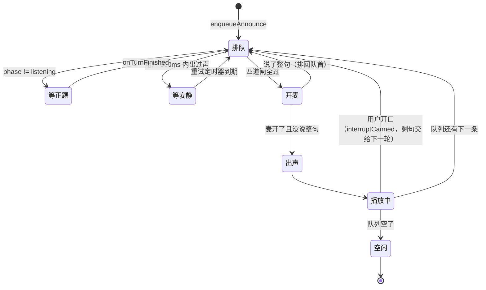

## 5.6 OmniShadow —— 音频直出车道

**持有**：`VoiceConnection.omni`（`src/omni-shadow.ts`，**按设备连接建、按连接销毁**）。
**驱动**：`UtteranceAssembler` 的三个回调（`onSpeechOpen` / `onSpeech` / `onCommit`）
推音频，`TurnRunner` → `FrontedAgent` 认领或丢弃。

> **硬约束：`OMNI_ANSWER=full` 时，快车道每一轮都必须由 omni 答。**
> 一轮退回级联，用户就在同一段对话里听到两副嗓子。验收口径见本节末。

### 状态

| 状态 | 含义 |
|---|---|
| `idle` | 还没建连（`assert` 之前的一切入口都是空操作） |
| `connecting` | socket 已发握手，等 `session.updated`（实测 ~1.3 s） |
| `ready` | 可发 `commit`+`create` |
| `busy` | 有一份 response 在生成（`resp !== null`） |
| `broken` | **吸收态，不自动重连** |

| 事件 | 从 | 到 | 条件 / 副作用 |
|---|---|---|---|
| `start()` | `idle` | `connecting` | 与设备握手**并行**，不占关键路径。握手超时 15 s → `broken` |
| `session.updated` | `connecting` | `ready` | 握手完成即就绪，**没有「预热 seal」**（发假音频会白花钱 + 往第 0 轮塞脏历史） |
| `seal()` | `ready` | `busy` | `commit` + `create` **连发**（pipe）。create 每推迟 1 ms 首块就晚 1 ms，决策预算只有 ~171 ms |
| `seal()` | `busy` | `busy` | 先 `response.cancel()`，把这一份排进 `pending`（只留一份），`done` 之后补发 |
| `response.done` | `busy` | `ready` | 同时 flush `pending`（→ `busy`）和排队中的回注 |
| `response.done` / `error` / `close` | 任意 | `broken` | 落 `{skipped:'broken', why}`；`stop()` 也走这里 |
| 一份 response 30 s 没 `done` | `busy` | `broken` | 看门狗，防挂死（**不是性能判据**） |

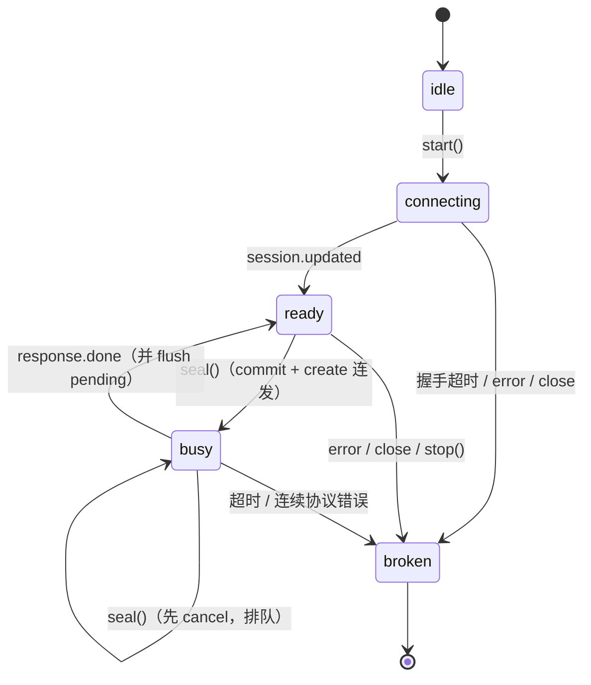

### 子状态一：闭嘴（`muted` + `ring`）

能量门 `holdMs`（2 s）比 `commitMs`（20 ms）长得多，所以**封段之后还会收到 ~2 s 静音**。

| 事件 | `muted` | 动作 |
|---|---|---|
| `seal()` | `true` | 之后一段都不往服务端推 |
| `feed(pcm, voiced=false)` | `true` | 只进 `ring`（上限 150 ms），**一个字节都不发** |
| `feed(pcm, voiced)` | `true` | `muted=false`，先补 `ring` 再追加（软起音不被切掉） |
| `feed(…)` | `false` | 直接追加 |
| `restart(preroll)` | `false` | 新一轮开口：cancel 上一份 → 清 `pending` → 有残留就 `commit`（**不发 create**）→ 补预卷 |

`voiced` 必须由能量门给（`EnergyGateDecision.voiced`），不能自己按能量重算 ——
两处门限一漂移就开始丢字或灌静音，而且从数据上分不出来。

### 子状态二：认领（谁拿走这一份）

| 字段 | 含义 |
|---|---|
| `resp` | 当前这一份（`response.done` 一到就置 `null`） |
| `pending` | 撞 busy 时排队的那一份（只留一份，`SealMeta` 钉住字节数） |
| `claimReserved` | 已经答应给某个消费者，但那一份还没建出来 |
| `claimedResp` | **认领落在哪一份上**（引用，不是事后去 `resp` 里找） |

两处容易写错：

1. **`willServe()` 必须看得见 `pending`。** 撞 busy 之后「cancel 掉旧的 + 新的排队」，
   而新的要等旧的 `done` 才建 —— 实测空窗 **92 ms**。只看 `resp` 会在这窗口里判 false，
   整轮退回级联，而 omni 那份 1 s 的回答生成完没人要（真机 2/38 中招）。
2. **`claimedResp` 不能省。** `finish()` 一到就把 `resp` 置 null，而异步 generator 的
   第一个 `next()` 是微任务 —— response 若在消费者开始读之前就 `done`，事后去 `resp` 里
   找只会得到 null，表现是静默等 5 s、零音频。

### 与主链路的接缝（三处，各管一件事）

| 位置 | 做什么 |
|---|---|
| `voice-session` 三个回调 | `onSpeechOpen` → `restart(preroll)`；`onSpeech` → `feed(pcm, voiced)`；`onCommit` → `seal(seq, silenceMs)`，**与 `stt.commit()` 同一行** |
| `FrontedAgent` | `isPrefetchable()` 里压住投机（不压就是每轮双花 LLM 钱）；`reply()` 认领；`delegate()` 先 `discard()`；`noteServedTurn()` 写回 `pending`；`injectAnsweredTurn()` 回注委派轮 |
| `TurnRunner` | 起跑流式 TTS **之前**问 `willServeAudio()`；`reply.audio !== undefined` 走直出分支；drain 之后才读 `speech` |

三种「不采纳」的语义**不能混**：

| 入口 | 取消 | 删半句 | 为什么 |
|---|:--:|:--:|---|
| `discard()`（走 dsh / 判据否决） | ✅ | ✅ | 一个字都没播 |
| `cancelCurrent()` 且 `!claimed`（同句第二次封段顶掉） | ✅ | ✅ | 那份答的是半句话，没人听过 |
| `interrupt()`（播到一半被插话） | ✅ | ❌ | 用户已经听到了一部分，删了就和 `pending` 里记的半句对不上 |

`item.delete` 只能**延迟**到 `response.done`：要 item id，而 id 在
`response.done.response.output` 里，discard 当场通常连 `created` 都没到。

### 验收：怎么知道硬约束还成立

`agent.lane` 每次 `willServeAudio()` 落一条，其中：

```text
lane_ok:false && text_ok:true   ⇒  该 omni 答却没答，整轮退回级联
```

**这个数必须是 0。** 文本闸（`text_ok:false`）不是违约 —— 那种轮次本来就不属于快车道，
一直是交给 dsh 的。`omni.shadow` 的 `cancelled`/`skipped` 另有口径（影子数据，不是接管）。

## 5.8 怎么验证状态轮转真的对

上面每节写的「转移条件」，代码里对不对不能靠读 —— 跑一场，看档案：

```bash
node --experimental-strip-types scripts/fsm-trace-check.ts <档案目录 | events.jsonl>
```

审计器在 [`src/fsm-trace.ts`](../src/fsm-trace.ts)，判据全部来自本文件与代码里的既有事实：

| 规则 | 违反时的意思 |
|---|---|
| `turn.nested` / `turn.orphanEnd` / `turn.unclosed` | 串行队列漏了，或者某轮被丢下 |
| `state.whitelist` | 有人绕过 `transition` 改状态，或转移表被改动 |
| `state.afterClose` | `closed` 之后还有活的东西在跑 |
| `state.audioBeforeSpeaking` | 先出声后进 `speaking`（插话窗口会错位） |
| `state.turnCovered` | 一轮里没见过 `thinking`/`speaking`（通知链断了，就是 P0-1 那类） |
| `state.settledAfterTurn` | 一轮结束后没落回 `listening`/`ending` |
| `barge.noAudioStop` | 被判插话却没发 `audio.stop`（喇叭停不下来） |
| `turn.tooLong` / `timing.stopToFirst` | 挂住，或者用户等太久 |
| `lane.fallback` | `agent.lane` 里 `lane_ok:false && text_ok:true` —— 该 omni 答却退回级联，**用户会听到两副嗓子**（§5.6） |

状态事件来自 `dialog.state`（`DialogRuntime.notifyState` 落档）。**老档案没有这个事件**时，
状态那几条记「缺仪表」跳过 —— 与 `latency-report` 的 `null` 口径一致，不拿「没记录」冒充「没问题」。

## 6 一轮对话的完整时序

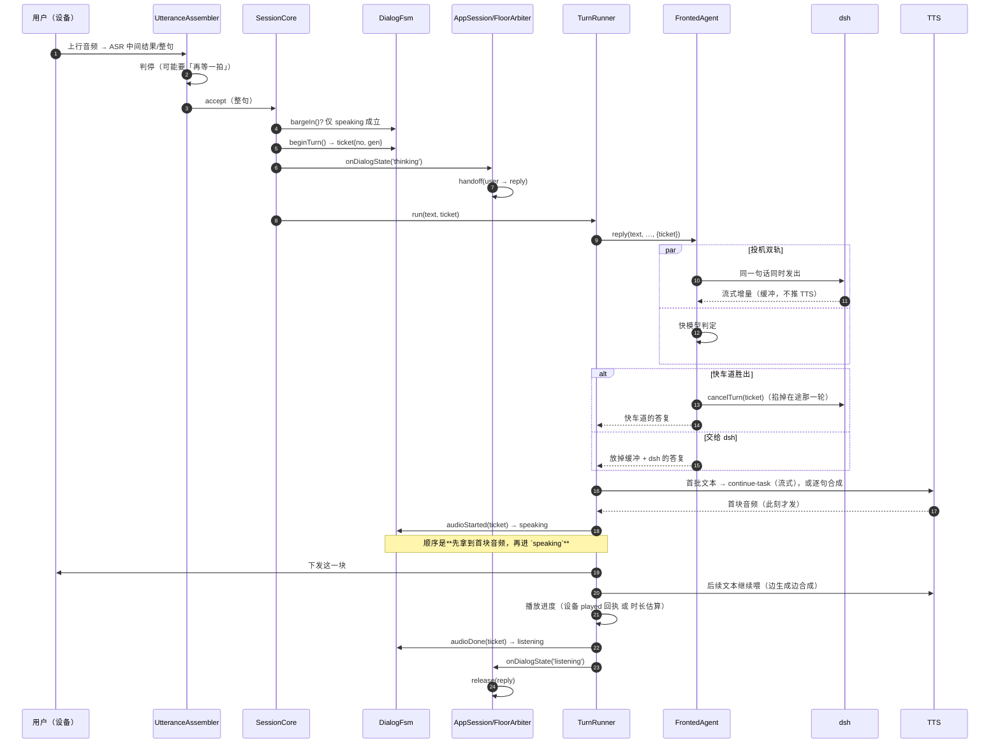

> **`audioStarted` 的位置别画错**（2026-11-19 核对）：它在 `turn-runner.ts` 的 `emit()`
> 里，紧挨着 `downlink.sendAudio()` —— 也就是**首块音频真要下发的那一刻**，不是回复
> 文本到达时。`fsm-trace.ts` 的审计规则「`tts.first` 必须落在本轮、且在 `speaking`
> 之后」就是靠这个顺序成立的。
>
> 一张画早了的图会让人以为「进入 `speaking` 到出声之间有 380 ms 空窗、吸收窗口因此
> 缩水」——**不成立**。那张图如果真搬到代码里，`speaking` 就会在用户听不见东西的时候
> 成立，插话窗口反而错位。

### 分支 A：用户插话

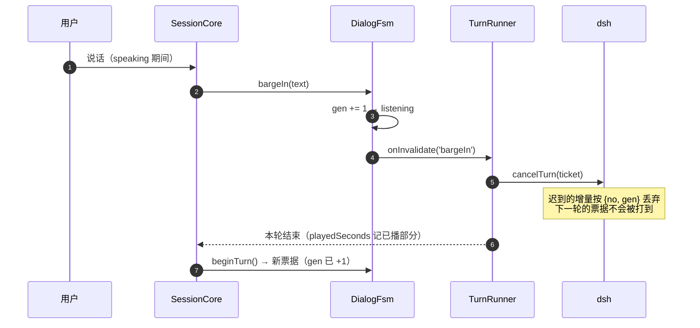

### 分支 B：快车道胜出

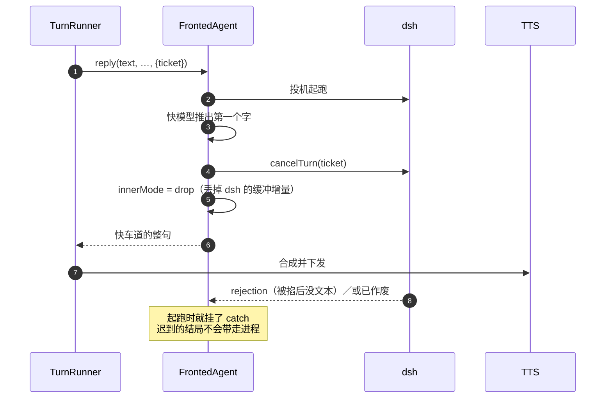

### 分支 C：omni 直出（`OMNI_ANSWER=full`）

omni **不等定稿**：它的起跑线是 `onCommit`（封段），与 `stt.commit()` 同一行。

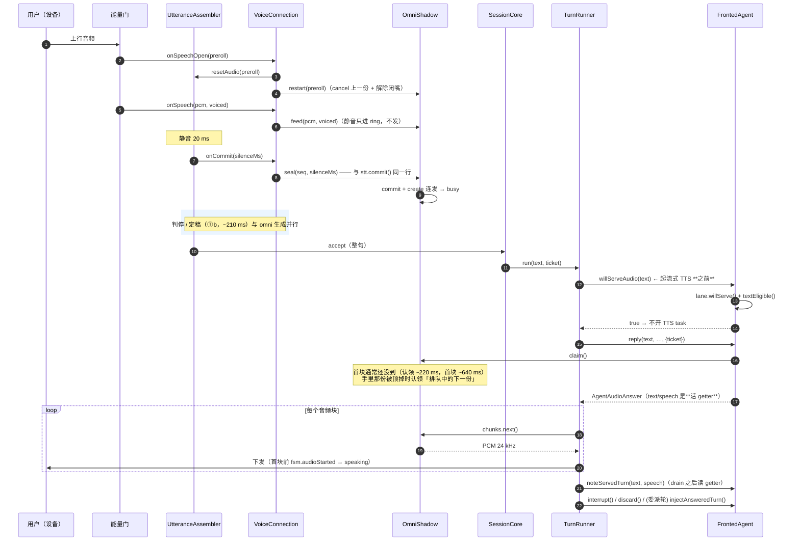

三条与 §6 主图不同的地方，都是有意的：

| 差异 | 为什么 |
|---|---|
| omni 在 `onCommit` 起跑，早于 `beginTurn()` | 推迟 241 ms 到定稿才 `create`，首块从 664 掉到 887，输给级联的 835 |
| `willServeAudio()` 在流式 TTS 之前问 | 那一步会真开一个合成 task，而 omni 轮没文本可送，服务端拒空文本 → 整轮退化 |
| `speech` 在 drain 之后才读 | 它是活 getter；被打断时当前值正好是「已播出去的部分」，审计与续话要的就是它 |
