# 状态机一览

以**当前代码**为准（2026-11-24）。旧记录见 [ADR-0001](adr/0001-app-layer-and-pet.md)、
[ADR-0002](adr/0002-virtual-time-simulator.md)、[ADR-0003](adr/0003-deterministic-kernel.md)、
[ADR-0004](adr/0004-flattened-pipelines.md)；
与本文件冲突的地方已在各自文件里标注取代关系。

这份文档回答四个问题：每台机器有哪些状态、什么事件推动它、转移条件是什么、
**谁持有它、谁驱动它**。第 6 节是一条对话从开口到播完的完整时序。
第 7–11 节是后来收成显式相位的几台机器，以及它们共同守的不变量。

## 0 唯一真相

同一件事只允许有一个模块持有；其他模块通过下面这些入口**读**，不复制。

| 事实 | 唯一持有者 | 读法 |
|---|---|---|
| 话筒归谁 | `AppSession.floor`（`FloorArbiter.owner`） | `floor.busy` / `floor.owner`；宠物经 `PetWorld.floorBusy` 与 `floorTaken` 输入得知 |
| 当前相位 / 轮次 / 代次 | `kernel.ts` 的 `dialog` 区域（`KernelRuntime.state.dialog`）；`DialogFsm` 只是它的**薄门面** | `DialogFsm.ticket()` 读 `runtime.state.dialog.ticket` → `{no, gen, baseCommitSeq?, startedAtMs?}`；上游取消、迟到回调一律拿票据比对（`isStale` / `isCurrent`）。内核意图的唯一执行路径是 `KernelRuntime.dispatchAndApply` + `DialogRuntime.attachPorts`（`stopDeviceAudio` / `invalidateTurn` / `abortEngine` / `settleTurn`）；`SessionCore` 不另发插话的 `audio.stop` |
| 播放进度 | 内核 `playback`（`sentMediaMs` / `playedAtMs`） | `devicePlayed` 写入 `playedAtMs`。`TurnRunner.playedSeen` 只打断「等到估算时长下限」的等待环，不算第二套 heard。结算仍只走 `settleTurn`；`DialogFsm` 只收 `audioDone(ticket)` |
| 这一轮听到多少 / 少听没少听 / 该不该回注 | `kernel.ts`（`step()` 的 `settleTurn` 意图；`stale` 归 `dialog` 区域、`truncated` 归 `playback` 区域） | `TurnRunner` 只喂事实（`audioSent` / `devicePlayed` / `ticketInvalidated` / `turnEnded`），结算数字**不许自己再算一遍**；回注口气 `inject` 三态（`spoken` / `unspoken` / `none`）也**只在这里算一次**；历史档案对账用 `scripts/kernel-replay.ts`。**因果旧段拦截唯一归口在 `kernel.ts::isPreTurnCommit`**（`kernel.isCausallyStale` 与 `SessionCore` 都调它；`voice-session.ts` 不再保留 `fromPreTurnSegment` 副本） |
| 这一轮先由谁答 | `turn-router.ts::routeTurn()`（纯函数，判据与引擎实现无关）；`live` 另由车道健康度与 omni 自己的 `tool_call` 决定 | `CascadeAgent` / `FrontedAgent` 问 `routeTurn()`。`TurnRunner` 不判，也不按 `reply.audio` 分叉：它只消费 `respond()` 的 `EngineEvent` |
| 上一轮谁答的 / 少听没少听（路由与回注要读） | `FrontedAgent.ledger`（`ConversationLedger`，只记已结束的轮次） | `lastAnsweredLane()` 给 `routeTurn()` 的 `lastLane`；`pet` 轮不算"答过用户"。`KernelPorts.settleTurn` 把后验的 `truncated` 与 `endedAtMs` 按 `{no, gen}` 精确回写（`ConversationLedger.reconcileOutcome`）；重连时 `DialogRuntime` 用 `agent.lastLedgerLane()` 播种 `initialKernelState` 的 `lastLane`，两份账不漂 |
| 判停中的文本 | `UtteranceAssembler`（`pendingText`） | 上层只在 `onUtterance` 拿到整句，拿不到半句 |
| 快车道闸门 | `FrontedAgent.innerMode`（`pass` / `buffer` / `drop`） | dsh 的流式增量按闸门决定直通、缓冲还是丢弃 |
| 委派回执 | `TurnRunner.receipt`（+ `receiptPlaying` / `firstAudioSeen`） | 出声前锁存票据，`receiptStarted(ticket)` / `receiptEnded(ticket)` 由内核按 `{no, gen}` 核对。自然播完先在 `this.receipt === current` 时把引用清掉，再 `receiptEnded`。过期票是空操作 |
| 宠物状态 | `PetSession.state`（`PetState`） | 纯函数 `brain.step` 产出；执行器无判断 |
| 后台汇报什么时候开口 | `DialogRuntime.announceQueue` + 四道闸；Pure Live 的开口结果在 `speakAnnounce` | `queue.length > 0` → 宠物闸门 `floorFree` 不通过（`announcePending`），宠物自己不说话；`announce` 抢不动 `reply`。开口三态见 §5.7：`spoken` / `defer`（排回队首）/ `fallback`（逐字 TTS，再静默回注） |
| 后台任务跑到哪 | `BackgroundTaskBus` 上每条任务的 `state` | `queued → running → completed \| failed \| cancelled`。同一 `turnNo` 上 `early_rule` 与 `tool_call` 去重，还在排队时 `tool_call` 升级查询；`memory_silent` 不进这张去重表、也不播报。插话不取消，显式取消才停，迟到结果不再汇报。见 §5.7 |
| 这一轮的出话泵 | `TurnRunner` 持有的那一个 `FastVoiceEngine` | `run()` 只 `for await` `respond()`。`VOICE_PIPELINE=live\|cascade` 启动时二选一，会话内不换泵。见 §5.9 与 [ADR-0004](adr/0004-flattened-pipelines.md) |
| omni 车道状态 | `VoiceConnection.omni`（`OmniShadow.state`：`idle`/`connecting`/`ready`/`busy`/`broken`） | `FrontedAgent.audioLane.willServe()` / `explain()`；宿主只经这两个入口读，不复制状态 |
| omni 那一份音频归谁 | `OmniShadow.claimedResp`（认领时绑定） | `AgentAudioAnswer.chunks` / `transcript()` 的闭包；**不许事后去 `resp` 里找**（见 §5.6） |
| 有声 / 连续静音 | `EnergyGate` 产出的 `AudioFrame`（`voiced` / `silenceMs` / `tsMs`） | 生产装配 `voiceDebounceFrames: 2`。`addFrame` 把这三字段原样交给 `SilenceTriggers`（`alreadyDebounced: true`），不再做第二套两帧去抖。见 §4 |
| 句边界相位 | `UtteranceAssembler._phase` + `evalEpoch` | 上层只在 `onUtterance` 拿到整句。`disposed` 是唯一吸收态。见 §4 |
| 开麦 | `VoiceConnection.micPhase` | 只经 `enterMic`。`closed` 之后不再出来。见 §8 |
| 浏览器客户端 | `createVoiceClient` 里的 `ClientPhase` + `startGen` | 清理只走一次 `teardown()`。见 §10 |
| DSH 主会话 | `DshSession.openSessionId` + `turnPhase` | 对不上主会话的事件只进 `TaskBoard`。进程代次是 `procGen`。见 §7 |
| 后台总线的会话代 | `BackgroundTaskBus.sessionEpoch` | 重连后同号 `turnNo` 不互相挡住 |

> **两个「封段」旋钮不是一回事**：`VOICE_COMMIT_MS`（20 ms）只让 **omni 车道**起跑
> （`omni.seal()`），`VOICE_STT_COMMIT_MS`（150 ms）才请 **ASR** 封段解码
> （`stt.commit()`）。两份档案事件用 `asr.commit.lane_seq` 配对，序号不混用。

> 播放口径：**估算时长是下限，设备回执只能延后**。真机上见过设备在「最后一批字节收到」
> 就报 `played`（4.58 s 音频 1 s 回执），按它收尾会把尾音那段插话窗口关掉。

> 「话筒」这条有三个历史坑，都已经收进 `FloorArbiter`：①`user` 不可抢占，所以
> `userFinal()` 里直接 `claim('reply')` 永远失败，话筒会卡死在 `user`（改用
> `handoff('user','reply')`）；②`AppSession.speaker` 曾是一份影子状态，与仲裁器重复；
> ③`syncFloor()` 曾试图「同步」两者，但它只是恒等式，什么都没做。②③已删除。

### 时钟与代次

三把尺子不混用（[ADR-0003](adr/0003-deterministic-kernel.md)）：

| 尺子 | 载体 | 用来判 |
|---|---|---|
| 因果 / 代次 | 下表这些序号 | 先后、过期、跨连接串台 |
| 媒体时间 | `AudioFrame.tsMs`、字节 / 采样率 | 起止、静音累计、`heardMs`、`truncated` |
| 墙钟 | 注入的 `clock.now()` / `clock.after` | 网络、RPC、握手、拍照、看门狗 |

跨 `await`、定时器、socket 回调、子进程 stdout 的恢复点，第一行核对「出生代次还在，且没进吸收态」。对不上就返回。

| 代次 | 持有者 | 挡住什么 |
|---|---|---|
| `procGen` | `DshSession` | 旧进程的 `close` / `error` / 2 s 强杀 |
| `openSessionId` | `DshSession` | 子会话事件写进主轮 `assistantText` 或提前 `idle` |
| `tailSwallow` | `DshSession` | 旧轮那条不带轮号的 `idle` / `turn/start` |
| 票据 `{no, gen, baseCommitSeq?}` | 内核 `dialog.ticket` | 上一轮迟到回调；插话作废排队轮 |
| `commitSeq` | 内核 `input` | 开轮前旧段（`isPreTurnCommit`） |
| `evalEpoch` + `seq` | `UtteranceAssembler` | 挂起的 `evaluate` / `rearmFromSpeakingMore` |
| `micEpoch` | `VoiceConnection` | 开麦宽限与等麦超时 |
| `wsGen` | `QwenRealtimeAsr` / `AliyunAsr` / `OmniTts` | 旧 socket 的 open / message / close |
| `startGen` | 浏览器 `VoiceClient` | `start()` 里还停在 `await` 的那一次 |
| `sessionEpoch` | `BackgroundTaskBus` | 重连后的同号后台任务 |

`OmniShadow` 这条连接不重连。吸收态是 `broken`，清理只走 `teardown()`，没有自己的 `wsGen`。

### 接线检查清单

「唯一真相」成立的前提是**包装层不吞东西**。2026-11-16 的只读审计抓到三处断点，
当时单测全绿、生产没接上，所以这三条各要有一条按生产装配跑的测试：

| 断点 | 现状 | 测试 |
|---|---|---|
| `beginTurn` / `audioStarted` / `audioDone` 都在 `TurnRunner.run` 里发生，`DialogRuntime.dispatch` 看不到 | `TurnRunnerOptions.onState` 在这三次转移后各回调一次，`DialogRuntime` 接到 `notifyState()` | `tests/wiring-floor-cancel.test.ts` 第一条 |
| `trackActivity` 只在方法存在时透传，内层没有 `cancelTurn` 就整条断面 | 已改成 `Proxy` 自动转发（`reply` 单独包一层，第四参 `turn` 原样带上） | 同文件第二条 |
| 票据在 `FrontedAgent` 内部换成 `localGen` 就丢了 | `delegate` / `abandon` / `startInner` 都带票据，`inner.reply(..., { ticket })` | 同文件第二条 |
| 内核声明的意图没人执行（端口没绑），或旁路又发一份 | `DialogRuntime` 用 `KernelRuntime.attachPorts()` 绑生产端口，`DialogFsm` / `TurnRunner` 全走 `dispatchAndApply()`；`commitSeq` 因果屏障单通道；`settleTurn` 按 `{no, gen}` 回写账本 | `tests/kernel-effects-wiring.test.ts` |

## 1 DialogFsm —— 一轮对话的生命周期（内核门面）

**持有**：`SessionCore.fsm`，但它只是 [`kernel.ts`](../src/kernel.ts) +
[`kernel-runtime.ts`](../src/kernel-runtime.ts) 的**薄门面** —— 真正的状态在
`KernelRuntime.state.dialog`，本类不再持有 `turn` / `gen` / `endAfterSpeech` /
`receiptOnly` / `lastWhy` 的第二份，只把方法调用翻译成 `KernelEvent` 并读快照。

**驱动**：`SessionCore`（ASR 整句、插话、模型要求结束）与 `TurnRunner`
（开轮、首块音频、音频结束）。两者都只是往**同一个** `KernelRuntime.dispatchAndApply()` 喂事件，
所以相位与账本不会各算一份。

### 状态

| 状态 | 含义 |
|---|---|
| `listening` | 话筒在手，等用户说话 |
| `awaiting_shot` | 已答应「拍张高清的」，等图到手再开这一轮 |
| `thinking` | 一轮已开，等上游（dsh / 快车道）出结果 |
| `speaking` | **有声音在播**。可能是答案的首块音频，也可能只是委派轮的回执（靠 `receiptOnly` 区分） |
| `ending` | 要收尾了（模型说了再见），本轮播完就关 |
| `closed` | 吸收态：连接已断，任何迟到回调都不得把状态拉回去 |

> `speaking` 的含义是「**用户这会儿听得见东西**」，不是「答案开始了」。委派轮那句回执
> （「我看看。」）也占这个状态 —— 判据是**有没有声音**，不是「有没有在等模型」，否则
> 用户听完回执说「不用了」会被当成同一句的下文合并，而不是插话。

### 事件与转移

| 事件 | 从 | 到 | 条件 / 副作用 |
|---|---|---|---|
| `beginTurn()` | `listening`、`awaiting_shot`、**`thinking`** | `thinking` | 内核铸新票（`no = turn + 1`，`gen` 不变，锁存 `baseCommitSeq` / `startedAtMs`）；在 `ending`/`closed` 时返回 `null`，调用方放弃这一轮 |
| | | | **`thinking` 是合法前驱**：用户在模型还在跑的时候又说了一句 → 新票据让旧票过期，旧轮的结果被 `isStale` 丢弃。**这就是「出声前吸收窗口」的实现方式**，真机上一半的句中停顿都走这条路。以前这里记成「⚠ 调度 bug」（注释写着「串行队列保证不会到这里」），是**错的** —— 按注释去「修」它，等于取消吸收窗口 |
| `beginAwaitShot()` | `listening` | `awaiting_shot` | 不在 `listening` 时返回 `null` |
| `abortAwaitShot()` | `awaiting_shot` | `listening` | 代次不变 |
| **`receiptStarted(ticket?)`** | `thinking` | `speaking` | 置 `receiptOnly`。带了票据时内核 `acceptsReceiptTicket`：当前票非空，且 `causal.isStaleTicket` 为假（`no` 与 `gen` 一起比）。过期票、或不在 `thinking`，返回 `false`，这一轮不出声。`beginTurn` 开新轮时无条件把 `receiptOnly` 清成 `false` |
| **`receiptEnded(ticket?)`** | `speaking` 且 `receiptOnly` | `thinking` | 过期票，或 `receiptOnly` 已经清掉：空操作，相位不动。回执被真音频顶掉后再调也是空操作 |
| `audioStarted(t)` | `thinking` | `speaking` | 票据须 `{no, gen}` 都对上当前轮；**清 `receiptOnly`**（真音频接管）。**触发点是首块音频要下发的那一刻**（`turn-runner` 的 `emit()` 里，紧挨着 `sendAudio`），不是回复文本到达时 |
| `audioDone(t)` | `thinking`、`speaking` | `endAfterSpeech ? ending : listening` | 本轮相位的收尾出口。票据对上才走，并清掉 `receiptOnly`。回执自己播完走 `receiptEnded`（回 `thinking`），不走这里。`turnEnded` **不改** `dialog.phase`，只结算 `playback` 与 `ledger` |
| `requestEnd()` | `listening`、`awaiting_shot` | `ending` | 在 `speaking`/`thinking` 只置标志，让告别语播完 |
| `bargeIn(why, commitSeq?)` | **仅** `speaking`（含回执那段） | `listening` | 先过因果屏障：带 `commitSeq` 时 `kernel.ts::isPreTurnCommit` 判「开轮前录的旧段」，是旧段就不算插话（相位不动、返回 `false`）。成立时 `gen += 1`（作废排队轮次）→ 清 `receiptOnly` → 内核声明四条意图：`stopDeviceAudio`、`invalidateTurn(ticket, 'bargeIn')`、`abortEngine('barge_in')`、`settleTurn`（当场按媒体游标结算这一轮），由 `KernelRuntime.dispatchAndApply()` 经 `KernelPorts` 各执行一次 |
| `close()` | 任意 | `closed` | 宣告这一轮作废（内核发 `invalidateTurn(ticket, 'closed')`）→ 清票 |

票据 `{no, gen, baseCommitSeq?, startedAtMs?}` 是**唯一的轮次令牌**：`no` 每轮 +1，
用来丢上一轮迟到的回调；`gen` 只在插话时 +1，用来作废还排着队的轮次；
`baseCommitSeq` 是开轮瞬间锁存的因果水位线（见 `causal.ts`）。

**上游取消只有一个落点，入口按装配分两种**：

| 装配 | `invalidateTurn` 怎么走到 `agent.cancelTurn` |
|---|---|
| 生产（`DialogRuntime`） | `KernelRuntime.attachPorts()` 绑的 `ports.invalidateTurn(ticket, reason)` → `TurnRunner.invalidateTurn(ticket, reason)` → `agent.cancelTurn(ticket)`。看见 `fsm.runtime.ports !== null` 时 `TurnRunner` **不再订阅** `fsm.onInvalidate` —— 两条都订就是同一条意图解释两遍（`cancelTurn` 联动 `detachTurn` 会让 dsh 丢答案） |
| 裸跑 `TurnRunner`（单测 / 离线，没有端口） | 没人执行内核意图，`TurnRunner` 退回订阅 `fsm.onInvalidate`。它本身也只由内核那条 `invalidateTurn` 意图触发（`DialogFsm` 的订阅只看 `effects`，不按事件名重算） |

两条入口都落在同一个 `TurnRunner.invalidateTurn`：严格按 `{no, gen}` 比对 + 幂等。
所以「插话」和「连接结束」走的是同一条取消管道。**「快车道胜出后掐掉慢车道」不走这条**
——那是 `FrontedAgent.commit()` 里的 `cancelInner(ticket)`，属于同一轮内部的分支切换，
不是轮次作废。

### 出声前的吸收窗口 = `thinking → thinking`

用户说完一句、模型还在跑（`thinking`），这期间他**又开口**，实际发生的是：

1. ASR 定稿 → `SessionCore.dispatch` 的 `utterance` 分支 —— 它**不检查当前相位**
2. `fsm.beginTurn()`（生产里的调用点在 `TurnRunner.run` 开头）→ 内核 `beginTurn` 铸新票
   （`no + 1`，`gen` 不变；同一轮谱系内沿用上一张票的 `baseCommitSeq` / `startedAtMs`），
   顺手结算还留在播放区里的上一轮（有残留音频时才发 `settleTurn`）→ `thinking → thinking`
3. 旧票不再是「当前轮」：`isCurrent(ticket)`（`no` 已前进）为假，旧轮的结果回来时
   一个字都不下发。`DialogFsm.isStale` 只比 `gen`，插话那次才 +1，这里不动 ——
   **`beginTurn` 自己不发 `invalidateTurn`**（只有 `bargeIn` 与 `closed` 发），
   所以它只让旧轮的输出作废，不去取消旧轮的上游。下发侧用 `TurnRunner.isTurnDead`：
   `isStale(ticket) || !isCurrent(ticket)`，`no` 或 `gen` 对不上都停
4. 快车道也不会走 `commit` → **不写进对话历史**

效果等价于「合并后重答」，但**实现是新轮取代旧轮**，不是把两段文本拼起来。

**为什么这条值得单列**：它就是「延迟越低、越容易被句中停顿切开」的那个吸收窗口本身，
却长期只在一句话里被提到，既没进事件表也没进审计。`beginTurn()` 里那句
「串行队列保证不会到这里」的注释曾经把这条正常路径记成调度 bug —— 按它去「修」，
等于取消吸收窗口。

**还没做的审计**（`fsm-trace`）：被取代的轮次（票 `no` 小于当前轮、且没有 `turn.end`）
不得出现 `tts.first` 或下行音频。真机上「半句当整句答」如果还在发生，先查这里。

### TurnRunner：回执、死票、旁白

`speakReceipt` 出声前读 `fsm.ticket()`，`receiptStarted` 失败就一句都不发。
`holdReceipt` 按音频时长占住 `speaking`，循环里看见 `cancelled` 或 `fsm.state === 'closed'` 就停。
醒来之后：

1. 仅当 `this.receipt === current` 时把它置成 `null`。悬空的旧回执不能清掉下一轮的引用，
   也不能让几秒后的正式回答误判「回执还在念」再发一条 `audio.stop`。
2. `receiptEnded(receiptTicket)`。票是出声时锁存的那张；内核按 `{no, gen}` 丢掉过期票。

`run()` 的 `finally` 先 `cancelActiveReceipt()`，再 `audioDone`。这样晚醒的 `holdReceipt`
只能拿旧票去 `receiptEnded`。

`isTurnDead` 用在 `emit`、`respond` 循环和播完等待上。`speakCanned` 的合成循环与播完等待
同样看见 `fsm.state === 'closed'` 就停，不再往已关的连接上送字节。

### PhotoInbox

**持有**：`DialogRuntime.photos`。`dispose()` 把 `disposed` 置上，取消在等的那一张
（`cancelled`），并拆掉兜底定时器。之后 `request()` 直接返回 `cancelled`，不再武装新定时器。
`DialogRuntime.dispose()` 会调到它；`enqueueTurn` 的串行链入口同时看 `disposed` 和
`fsm.state === 'closed'`。

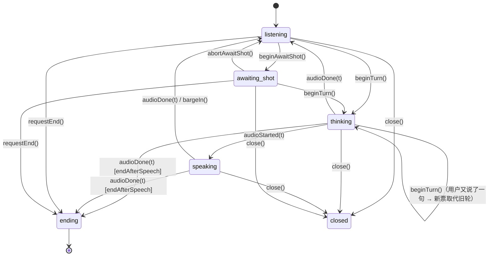

## 2 FloorArbiter —— 话筒

**持有**：`AppSession.floor`（`src/app/session.ts`），无论宠物开不开都建。
**驱动**：`TurnRunner.onState`（每轮的三次转移后回调）→ `DialogRuntime.notifyState` →
`AppSession.onDialogState(state)`；`turnStart()`/`turnEnd()` 留给模拟器与直接调用方；
`PetSession` 只管申请，不参与仲裁。

> `notifyState` 有去重（状态没变就不回调），所以**必须**在那三次转移之后各通知一次。
> 只在 `dispatch` 末尾和 `onTurnFinished` 通知时，一轮从头到尾只看到 `listening` 一个状态，
> `release('reply')` 永远不执行 —— 这是审计抓到的 P0-1。

状态就是「谁占着」：`null | user | reply | announce | pet | reflex`。

| 占用者 | 可被谁抢 |
|---|---|
| `user` | 无（用户永远优先） |
| `reply` | `user` |
| `announce` | `user`、敲击（应用层转成 `reflex`/`dismiss`） |
| `pet` | `user`、敲击；`announce` 不抢（等它播完） |
| `reflex` | 任何人 |

| 事件 | 条件 | 结果 |
|---|---|---|
| `acquire(who)` | 空着，或已是同一个人 | 拿到，`true` |
| `acquire(who)` | 按上表可抢 | 换人，`true` |
| `acquire(who)` | 不可抢 | `false`，调用方按 `floorTaken` 处理 |
| `handoff(from, to)` | 当前确实是 `from` | 直接换成 `to`，**不走抢占表** |
| `release(who)` | 当前是 `who` | 清空；不是则 `false` |

`handoff` 存在的唯一理由：`user` 不可抢占，而一轮结束时话筒必须从 `user` 交到 `reply`。
没有它就只能靠影子状态糊过去，那正是被删掉的 `speaker`。

FSM 状态到话筒的映射（`AppSession.onDialogState`）：

| FSM 状态 | 话筒 |
|---|---|
| `thinking` | `reply`（从 `user` 移交） |
| `speaking` | `reply`（整段播放都算应答在说话） |
| `listening` / `ending` / `closed` | 释放 `reply` |
| `awaiting_shot` | 不动（用户随时可以说话，话筒本来就该空着） |

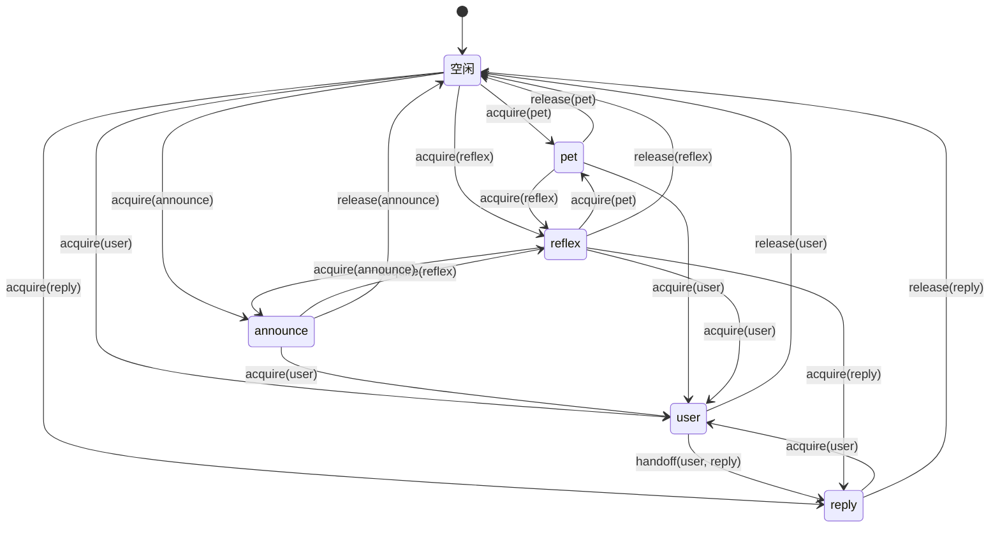

## 3 PetBrain —— 主动开口

**持有**：`PetSession.state`（`PetState`，不可变，`brain.step(state, input)` 换成新值）。
**驱动**：设备事件与定时器经 `PetSession` 归一成 `PetInput`；`PetExecutor` 只执行
状态机产出的命令，不做判断。

`PetState` 四个字段：`world`（时钟、在戴、离场、话筒忙不忙、最近记录）、`engagement`
（当前这次主动开口，`null` = 没在开口）、`fired`（已触发候选的去重键）、`seq`（编号）。

主动开口是一个**阶段子机**：`look`（看一眼）→ `compose`（想说什么）→ `listen`（开麦等首帧）
→ `speak`（说）→ `await`（等回话）。每个阶段都有隐含的 `timeout`，报回结局用 `next`/`end`。

| 层 | 内容 |
|---|---|
| L1 顶层 | 戴上了吗、话筒空不空、够不够久 → 这次要不要开口 |
| L2 阶段子机 | 上面五段，每段登记「什么输入、什么结局」 |
| L3 决断表 | 阶段 × 打断（用户开口、敲击、话筒被占、离场）→ 继续 / 跳过 / 结束 |

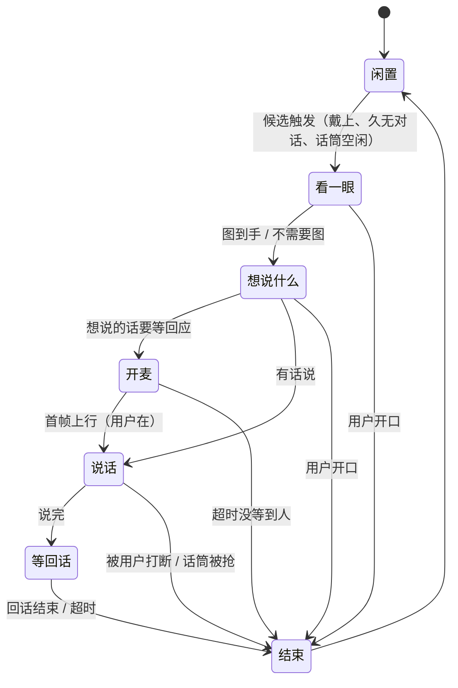

## 4 UtteranceAssembler —— 判停

**持有**：`voice-session` 的 `assembler`（`src/utterance-assembler.ts`）。
**驱动**：ASR 定稿（`addSentence`）、声学帧（`addFrame`）、预测器（`src/turn-judge.ts`，进程内 ONNX 声学判停）、定时器。
预测器特征在 `src/whisper-features.ts`，模型由 `src/runtime/turn-judge-bootstrap.ts` 的
`loadSharedTurnJudge()` 进程级加载并预热；`TURN_JUDGE_MODEL`（兼容 `SMART_TURN_MODEL`）指定路径。
相位只有 `setPhase` 能写；`disposed` 写进去之后 `setPhase` 直接返回。

| 状态 | 含义 |
|---|---|
| `idle` | 没有待判文本。`flush()` 把整句交出去之后回到这里 |
| `armed` | `addSentence` 已并入文本，静候窗定时器在走 |
| `judging` | `evaluate(seq, evalEpoch)` 正在跑 |
| `extending` | 静音闸 / 短碎片 / `p` 说没说完，再等一拍 |
| `speaking_more` | 缓冲文本还在，又收到去抖后的有声帧。在途 `evaluate` 必须让位 |
| `rearming` | 离开 `speaking_more` 之后，先等在途 ASR 解码，再决定要不要 `evaluate` |
| `disposed` | 吸收态。`addFrame` / `addAudio` / `notePartial` / `addSentence` / `flush` 入口直接返回 |

`seq` 在 `addSentence` / `flush` / `dispose` 加一，只跟文本边界走。
`evalEpoch` 在 `handleVoiced` / `addSentence` / `flush` / `dispose` 加一：重新开口不改 `seq`，
但必须作废已经挂在 `await` 上的那一趟。每次 `await` 之后走 `isStaleEval`：
`disposed`、`speaking_more`、`idle`、`seq` 变了、`evalEpoch` 变了、或缓冲被清空，都退出。
`rearming` 本身不算失效相位 —— 旧协程靠对不上锁存的 `evalEpoch` 让位。

| 事件 | 条件 | 结果 |
|---|---|---|
| `addSentence(text)` | 非 `disposed` | `seq++`、`evalEpoch++`，`extensions` / `waitedMs` / `unsureExtensions` 清零，相位 `armed`，到点 `evaluate(seq, epoch)` |
| `notePartial(text)` | 非 `disposed` | 只更新 `lastPartialText`。**静音满 `speculateMs`（默认 100 ms；显式 `≤ 0` 关闭）时**拿它投机，见 §5 |
| `addFrame` 有声 | 缓冲非空，且不是 `idle` / `disposed` | `evalEpoch++`，取消定时器，进入 `speaking_more`，武装断流看门狗 |
| 静音到 `rearmSilenceMs`，或看门狗 | 仍在 `speaking_more` 且 `seq` 没变 | 先入 `rearming`，`waitPendingDecode`；解码带回新定稿或代次过期就返回，否则 `evaluate` |
| `evaluate` 要再等 | 静音不够、短碎片、或 `p` 说没说完，且预算没满 | `extending`，定时器再到点重新 `evaluate`（同一 `seq` / `epoch`） |
| `evaluate` 收下 | 闸都过了 | `flush()`：`seq++`、`evalEpoch++`，`onUtterance`，相位回 `idle` |
| `dispose()` | 任意 | 直接写成 `disposed`，`evalEpoch++`，清定时器、缓冲和语义缓存 |

`rearmSilenceMs` 取 `openQuietMs` 与 `sttCommitAfterMs` 的较大者；两个都没配时退回
`quietMs` / `extendMs` / 100 ms 的较大者。看门狗比这个门槛再多 100 ms，并且不低于 350 ms。

### 声学事实：能量门、上行管道、静音触发

生产链路上「有没有声、静音多久」只从 `EnergyGate.process` 出来：

| 字段 | 含义 |
|---|---|
| `voiced` | 连续 `voiceDebounceFrames` 块过门限才为真。生产在 `VoiceConnection` 里传 **2**。不够数的尖峰保持原来的 `silenceMs`，不归零 |
| `silenceMs` | 自最后一块确认有声起的连续静音。有声块本身是 0 |
| `tsMs` | 这一帧读一次注入时钟。`AudioFrame.tsMs` 与能量门用同一个时刻 |
| `prerollFrames` | 开门时交出的预卷，每块已经标好 `voiced`。下游不再跑第二遍 `pcm16PeakDbfs` |

`UplinkPipeline.end()` 把 `closed` 置上。之后 `push` 与 ffmpeg 的 `onPcm` 直接丢弃，
断连尾包不再进门、不再触发 `onFrame` / `onSpeechClose`。

`SilenceTriggers.noteFrame` 在 `alreadyDebounced === true` 且带了 `frontSilenceMs` 时
（`addFrame` 就是这条），有声帧立刻推进 `lastVoicedAt`，四个阈值读 `frontSilenceMs`。
`addAudio` 老路径不带这个标志，仍自己做两帧去抖，并用 `atMs - lastVoicedAt` 算静音。
`commitAfterMs` / `sttCommitAfterMs` / `pauseDetectMs`：`undefined` 用各自默认，**显式 `≤ 0` 关闭**。
`speculateMs` 缺省 100；显式 `≤ 0` 关闭。`assemblerSilenceFromGate` 把配置里的 `0` 原样传下去。

**三个新增的门（2026-11-18 起，只在「端点由我们控」的 ASR 上生效）**：

| 门 | 何时 | 做什么 |
|---|---|---|
| `commitAfterMs`（`VOICE_COMMIT_MS`，默认 **20**） | 上行静音到点、且这段有音频 | 让 **omni 车道**起跑（`omni.seal()`，只封车道、不碰 ASR）。封早了多一段碎片，并段照拼 |
| `sttCommitAfterMs`（`VOICE_STT_COMMIT_MS`，默认 **150**） | 同上，但门槛更晚 | 让 **ASR 封段开始解码**（`SttSession.commit()`），一段只封一次。比车道晚，是为了不把同一个字切成两半；两份档案事件用 `asr.commit.lane_seq` 配对 |
| `openQuietMs` / `openQuietShortMs`（`VOICE_OPEN_QUIET_MS`，300 / 200；p ≥ 0.8 走短档） | 定稿到达时 | 要求「**截至此刻**」的连续静音 ≥ 门槛才允许 `accept`；不够就 `extend` 差额（`why=silence`）。防的是「换气被当成句尾」 |

> **短档不是死代码**（2026-11-19 核对四份真机档案，69 次判停）：静音门整体只触发 5 次（7%），
> 其中短档 2 次 —— `080409` 的 `p=0.981 / 静音 196ms / 实等 4ms`、`094025` 的
> `p=0.823 / 静音 137ms / 实等 63ms`。**这两次都靠 200 而不是 300 才只等了 4 / 63 ms**，
> 删掉短档会让它们各多等 100 ms。触发率低是真的，「从不生效」不成立。

两帧去抖的来历：那段录音里 20 ms 的「有声」有 14 处，多是塞音闭塞段。单帧就清零
`silenceMs` 会让开轮门槛永远不成立。生产上这一刀在 `EnergyGate` 里做完
（`VoiceConnection` 传 `voiceDebounceFrames: 2`）。

### 神经 VAD、最短人声、分层预卷

`loadSharedVad`（`src/runtime/vad-bootstrap.ts`）在进程启动时加载一份共享 Silero v5。
`VOICE_VAD=energy|0|off|false` 直接用能量门。其余值（含缺省 `auto`）找到
`models/silero_vad.onnx` 就加载；找不到或加载失败只打一行日志，返回 `null`，不阻断启动。
每条连接 `createStream()`，`UplinkPipeline` 把放大后的 PCM 切成 32 ms（512 点）送进模型，
概率再交给 `EnergyGate.process`。没有流时仍是纯能量门。

神经模式是双阈值滞回，外加底噪：

| 条件 | 判据 |
|---|---|
| 还没进入本段人声 | 概率 ≥ `0.45`，并且峰值 > `−62 dBFS` |
| 已经确认在说话 | 概率 ≥ `0.30`（下沿），峰值仍要过底噪 |
| 相位是 `speaking`、本段人声还没确认 | 起音改成 ≥ `0.65`，并且连续 **4** 帧（`speakingDebounceFrames`，与两帧去抖取较大值） |
| 同一段回声窗、但没有神经概率（纯能量门） | 开门门限再抬 **`+6 dB`**，同样连续 4 帧。已经确认在说话之后不抬，避免把后半句切掉 |

`speaking` 来自 `DialogFsm.state === 'speaking'`，由 `UplinkPipeline` 的 `isSpeaking` 读。

最短有效语音是 `SilenceTriggers.minSpeechMs`。生产由 `DEFAULT_MIN_SPEECH_MS`（**120**）
填进 `gate.minSpeechMs`。本段已确认有声累计不够时，封段、ASR 封段、投机、判停预跑都不开火。
`0` 或缺省不设门槛。这 120 ms 本身不加等待，只挡住短噪声尖峰。

预卷分两层，都从同一次开门的缓冲里切，不各算一遍能量：

| 消费者 | 长度 | 常量 |
|---|---:|---|
| TurnJudge（`assembler.resetAudio`） | 800 ms | `DEFAULT_GATE_PREROLL_MS` |
| ASR 与 Omni（`stt.feed` 预卷、`omni.restart`） | 尾部 320 ms | `DEFAULT_ASR_PREROLL_MS`。大于等于整段预卷时不裁 |

这两个毫秒数是 `src/voice-config.ts` 的源码常量，不读 `VOICE_MIN_SPEECH_MS` / `VOICE_ASR_PREROLL_MS`。

**QoS：`②` 的等待预算（2026-11-18）**

| 旋钮 | 线上值 | 作用 |
|---|---:|---|
| `waitBudgetMs`（`TURN_JUDGE_WAIT_BUDGET_MS`） | **200** | 这一轮为等判停**最多**花多少毫秒，用完就收下。200 是按「模型段 ~184 ms」定的：等待基本藏进模型耗时；模型变慢要重算。取代「分支额度 × 每拍」那种随分支数量漂移的上限（真机 7/29 轮把额度吃干净，单轮白等 1.4 s） |
| `waitBudgetSequenceMs`（`TURN_JUDGE_SEQUENCE_BUDGET_MS`） | 1200 | 句尾像**未完成的序列**（数字 / 字母 / 「然后」…）时给**更大的预算**：这类句尾 p 判「没说完」**是对的**，别被总预算掐掉（真机一句手机号被拆成 3–4 轮）。判据复用 `looksUnfinished()`，纯机械。**只换预算，不换拍数**（原来是 12 倍拍数豁免，一个正则压过所有数值限额 —— 已删） |
| `maxOpenSilenceMs`（`TURN_JUDGE_MAX_OPEN_SILENCE_MS`） | 650 | **统一上限**：开轮时连续静音的天花板。放在所有分支之前，谁都不能绕过 —— 原来静音闸门在预算判断之前 `return`，实测把 ② 顶到 2264 ms。到顶就放行并落 `whyAccept:'cap'` |

`grace`（刚收到中间结果就再等一拍）和 `unfinished`（结尾像没说完的文本正则）已在
`ed87bc7` 删除：真机 2 场 87 次 extend 里命中 0/8 与 0/3，白等 3950 ms。
现在**只有三条**会加拍：静音闸门、短碎片、`p` 说没说完。其余情况一律收下。

落档同时加了三个字段：`silenceMs`（此刻连续静音）、`waitedMs`（这轮已等多久）、
`budgetMs`（这轮的预算）—— 以后要按真实分布做自适应标定，数据先攒着。

「再等一拍」是这里主要的延迟来源，**与状态机无关**：回放里同一句话的
「② 判停→开轮」在 151 ms 和 625 ms 之间跳，就是这一拍要不要等。
（开轮门槛例外：定稿本身就晚于停嘴 ~260 ms，多数轮次它不花时间。）

**这 200 ms 和投机的命中率是同一枚硬币**：判停愿意等满预算的轮次，投机更容易命中
（`agent 段 0–15 ms`）；判停立即收的轮次，投机要么来不及、要么靠 `prefetch` 提前量。
**但这不是硬地板** —— 真正的浪费是「投机已经跑起来又被并段重起」那个 bug
（已修 `830768d`，见 §5），以及「提前量够不够」，两者都与 200 ms 这个数字无关。
实测账见 §5 的「投机什么时候起跑」。

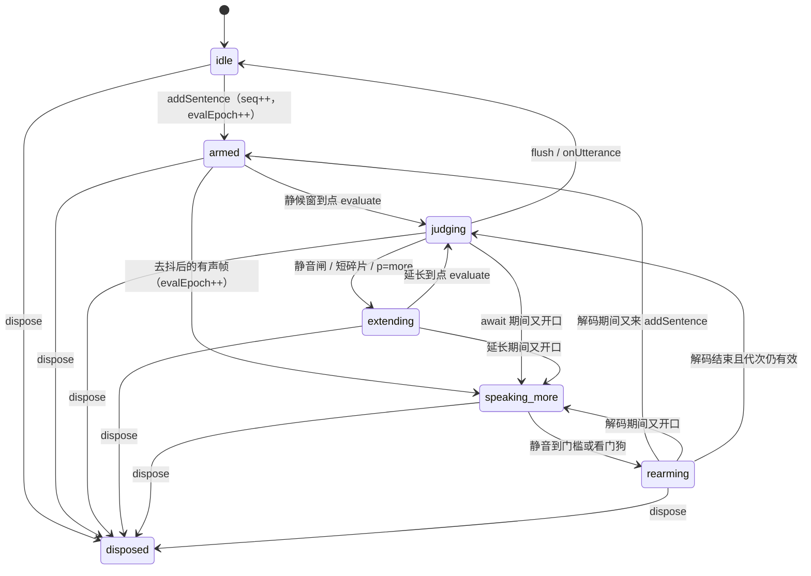

## 5 FrontedAgent 快车道

**持有**：`FrontedAgent.innerMode`（`pass` / `buffer` / `drop`）+ 本地对话窗口。
**驱动**：`TurnRunner` 调 `agent.reply(text, …, {ticket})`；内部先做**形态判据**，再决定
问不问快模型。

> 判据只挡形态，**不判语义**（2026-11-19 起）：空、超 `FAST_LANE_MAX_CHARS`、含阿拉伯数字。
> 这是**级联车道内部**「值不值得问快模型」的判据；「这一轮先由谁答」在
> `turn-router.ts` 的 `routeTurn()`（omni 只看健康度，不吃这几条文本前提）。
> 语义上该不该转交由模型在流里输出 `[[DELEGATE]]` 决定 —— 本地词表判过一版，
> 「你看过星球大战没？」「为什么？」因为含「看」「为什么」被一票判成任务，真机 92 轮里 25 轮白走 dsh。

| 状态 | 含义 |
|---|---|
| 判定 | 超长、带图、像长期事实、上句 dsh 在等回话 → 直接 `delegate` 给 dsh，**不问快模型** |
| 投机起跑 | `speculate` 开：dsh 与快模型同时起跑，dsh 的增量先缓冲（`innerMode=buffer`） |
| 快模型流式 | 只看到开头两个字就能判暗号；`[[DELEGATE]]` 判为委派 |
| 胜出 | `commit`：`innerMode=drop`、掐掉在途 dsh（`cancelTurn`）、把这一轮记进窗口 |
| 让路 | `abandon`：放掉缓冲的 dsh 增量（`innerMode=pass`），转用 dsh 的结果 |

| 事件 | 结果 |
|---|---|
| 首字到达 | 立刻掐掉在途 dsh（不为等它整段答完而拖首字） |
| 暗号 `[[DELEGATE]]` 出现 | 一个字都不推给 TTS，转 `abandon` |
| 超时（首字 1200 ms / 整句 2800 ms） | `abandon`，照实报「交给 dsh」 |
| 空答复（清洗后没有可念的文本） | `abandon`，不能哑 |
| 第一句就说完了 | `commit` |

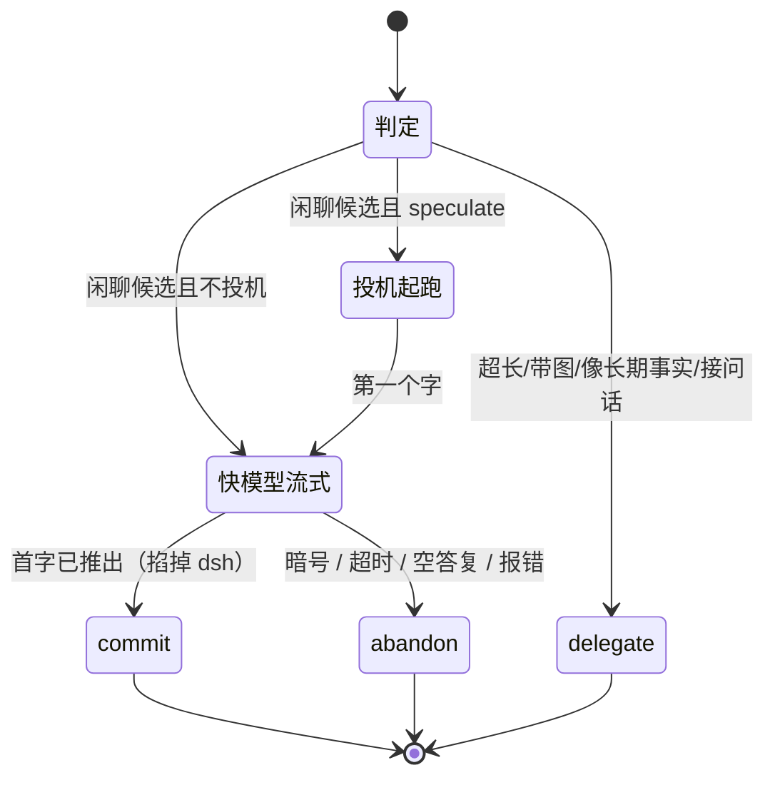

`commit` 之后 dsh 那一轮**一定**要接住 rejection：它被掐时经常以「清洗后没有可朗读的
内容」收场，而 `commit`/`abandon` 挂得比「掐」晚，中间这段窗口里没人接就是进程级未捕获
（线上真挂过一次，见 [fsm-align-report](fsm-align-report.md)）。

### 投机什么时候起跑（**别改成「中间结果一到就发」**）

投机由 `UtteranceAssembler.maybeSpeculate` 在**静音满 100 ms**（`VOICE_SPECULATE_MS`）
时触发，用手里已有的 `lastPartialText` 发出去。四条防呆各对应一次真机踩坑：

| 防呆 | 踩过的坑 |
|---|---|
| 这一版 partial 必须属于本段语音（`lastPartialAt > lastUtteranceAt`） | `lastPartialText` 不会跟着语音结束自动清空，上一段最后那版「嗯」被拿去猜下一句 |
| **接收方说发出去了才算一次**（`onPartial` 返回 `boolean`） | 门槛在 `FrontedAgent`、记账在组装器：一句被挡掉的「嗯」把整段语音的机会用光了（`071340` 轮 2/3/11） |
| 同一版 partial 只问一次（`specTriedText`） | 静音帧 20 ms 一个，不去重会每个 tick 刷一遍 |
| 真发出去了就不再问（`lastVoicedAt > specFiredAt`） | 后来补的 partial 重起跑，等于把已经跑掉的作废（`080409` 轮 11 认领时只剩 2 ms） |

每句最多 2 次（`specCount`，`addSentence` 归零）。

**「重试」是前两条的直接后果**（2026-11-19）：静音 100 ms 那一刻 partial 若还不够，
下一个静音 tick 会再问 —— 但只在 partial 变了的时候。三场真机算下来，「有投机」的
轮次从 2/11、5/14、3/17 提到 6/11、9/14、10/17，**但新增的提前量只有 14–30 ms**
（原来那些是 247–261 ms）。所以它改的是覆盖率，不改 p50。

### partial 到底到得有多晚（2026-11-19 实测，`scripts/partial-timeline.py`）

三场 52 轮。**每一档用同一把尺**：去全部标点后的覆盖率，不带字数门槛（原来把
「`acceptsSpeculation`（含 `minChars=6`）」和「覆盖 ≥90%」并列，才会出现
「更严的门槛达标更多」的假矛盾）。

| 判据 | 提前量中位 | p90 | max |
|---|---|---|---|
| 覆盖 ≥60% | 175–472 | 561–751 | 883 |
| 覆盖 ≥90% | 18–22 | 19–423 | 567 |
| 完全一致 | **16** | 19–313 | 423 |

**真正的问题不是「中位低」，是「60% 与 90% 之间隔着 600–750 ms」**：ASR 按语义段吐
partial，段与段之间一个字都不吐（`071340` 轮 4 从 −764 ms 到 −22 ms 有 742 ms 空档），
最后一段紧贴定稿。于是「可认领的 partial」分两类：

- **安全类**：段尾那版已经接近完整（`071340` 轮 1 在 −319 ms 就 90%），认领零风险；
- **陷阱类**：段中那版只有 60–70%，缺的正是**宾语**（`080409` 轮 4 缺「蓝母吗」、
  轮 5 缺「佛拉尼斯」），模型只能反问。

**线上判据已经收紧成「去标点后完全一致」**（`acceptsSpeculation`），陷阱类不再会被
认下来。代价是丢掉一类语义安全但不逐字一致的情形（「…是什么？」对「…是什么来着？」）。
收益几乎不损失：完全一致的提前量中位 16 ms，52 轮里还有 8 轮能白赚 300–423 ms。

**短句（≤6 字）单独看**：停嘴 +100 ms 时 19 轮里只有 3 轮接近完整，90% 覆盖的提前量
中位 12–16 ms —— 降门槛救不了，因为 partial 本身没到。例外是「partial 已等于定稿、
但 `asr.sentence` 还在等静音确认」那一类（`071340` 轮 6/10 各省 313/320 ms）。

**配额是硬约束**：带句末标点即发 + 完全一致认领时，每句 2 次 → 命中 25%，
3 次 → 62%，5 次 → 94%，但**中位提前量始终 6–8 ms**。所以配额保持 2。

认领时投机缺了哪几个字，现在落进 `agent.spec`（`spec` / `final` / `missing`），
事后能查「答非所问」是不是投机认下来的。

2026-11-19 试过两条改法并**全部 revert**，但**这两组数不能直接归因到触发时机**：

| 线上代码 | fast p50 | 档案 |
|---|---|---|
| 静音 100 ms（现状） | **1032** | `20261119-071340`，8 轮 |
| `notePartial` 一到就发（`1272bc1`） | 1176 | `20261119-080409`，11 轮 |
| 再加「说话中变长重来」（`bbf15ae`） | 1172 | `20261119-081608`，8 轮 |

后两场走「等满判停预算」的轮次更多（各 3 轮 ②=476），而那些轮次本来就是 1111–1172 ——
1176 / 1172 更像「那两场判停等得更多」，不是「更早投机有害」。

**逐轮审计查出来的真问题是**：投机已经跑起来之后，ASR 又补一版更长的 partial，
`speculatePartial` 判成「越改越长」→ `startPrefetch` 里 `dropPrefetch` + 重发。
`20261119-080409` 轮 11 的投机提前 **1370 ms**、文本与定稿一字不差，仍被重起，
开轮时那趟只跑了 **2 ms**。

已修（`830768d`）：变长时若旧文本覆盖新文本 ≥ `SPEC_MIN_COVERAGE`（认领用的就是这把尺），
**沿用**，且不消耗每句 2 次的配额。

「发出去的被自己扔了」确实存在且已修（`830768d`），但**它不是有效投机率低的主因**：
52 轮里能起跑的只有 2–5/14，且那 250 ms 的提前量里混着「陷阱类」。详见上面那张表。

⚠️ ①（停嘴→定稿）和 TTS 首包之外，**没有一处是物理硬地板**：
按 `partial 到手（~100）+ 模型（270）+ 合成（382）≈ 750 ms` 算，理论下限在那，
只是每一块都还没吃干净。账见 [LATENCY-CLOSURE](LATENCY-CLOSURE.md) §8。

⚠️ `fast p90` 只覆盖走快车道的那 85% 轮次，**整体 p90 由那 15% 的委派轮决定**
（`081608` 整体 p90 = 2525，因为 dsh 轮有 6463 ms 那种）。要「稳」绕不开委派链。

**判不出就给回执**：`delegate` / `abandon` 走到 dsh 时，`FrontedAgent` 叫一次
`setDelegateHook(reason)`，`DialogRuntime` 据此让 `TurnRunner.speakReceipt()` 说一句
四字回执（`我看看。` / `嗯，我想想。`）。它**不排 `speechChain`**（排进去本轮 TTS 要等它
播完才开工），答案的第一块一到就置 `cancelled` + `audio.stop`（否则两句叠在一起），
也不进残句缓冲（它不是「用户没听完的内容」）。真机那轮的空白就是这么补的：dsh 轮
`停嘴→首块 2934 ms`，回执在开轮后立刻出声。

**回执要占 `speaking`**：说不出声的话，用户听完回执再开口，`SessionCore` 会把它当成
「同一句的下文」合并进去（`thinking` 状态下的语音默认是追问/补充），于是「不用了」
顶不掉这一轮。所以出声前先 `fsm.receiptStarted(ticket)`（`thinking → speaking` + 置
`receiptOnly`），那句话播完 `fsm.receiptEnded(ticket)`（`speaking → thinking`）。
`receiptOnly` 标的是「这段 `speaking` 还只是回执」：真答案首块一到，`audioStarted()`
清掉它并留在 `speaking`。回执自然结束走 `receiptEnded`，回到 `thinking` 继续等答案。
过期票据两次调用都是空操作（§1）。回执期间用户开口 → `bargeIn()` 照常生效
（`gen += 1` 掐掉 dsh），这就是「回执可被打断」。

> 这两次转移**净变化为零**时 `notifyState` 会去重、不产生 `dialog.transition` 事件，
> 但 `dialog.state` 事件里的 `why` 能区分（见 `docs/TOOLS.md` §12.1）。

## 5.5 播报队列 —— 后台任务的结论什么时候开口

**持有**：`DialogRuntime.announceQueue`（+ `announcing`、`lastUserSpeechAt`、
`lastUserSentenceAt`、单个 `announceRetry` 定时器）。
**驱动**：`agent.setAnnouncer` → `enqueueAnnounce`；`onTurnFinished`；定时器重试。

播报**不属于任何一轮**：默认走 `speakCanned` 的旁白通道，不占轮次票据、不改状态机。
所以「等它该开口了」这件事只能自己判断，四道闸：

| 闸 | 条件 | 不满足时 |
|---|---|---|
| `disposed` / `announcing` / 队列空 | — | 直接返回 |
| 没有正题在跑 | `core.phase === 'listening'` | 返回，`onTurnFinished` 会再叫一次 |
| 用户真的安静了 | `now - lastUserSpeechAt ≥ 800 ms` | `scheduleAnnounceRetry(800 - quietFor)`，**只排一个** |
| 开麦窗口没被打断 | `lastUserSentenceAt ≤ mark`（开麦前记的时刻） | 排回**队首**，等下一轮 |

Pure Live（`VOICE_PIPELINE=live`）过了这四道闸之后不直接合成：挂了 `speakAnnounce`
就先问 omni 同一副嗓子。`spoken` / `defer` / `fallback` 以及 `origin: 'announce'`
的隔离见 §5.7。`verbatim` 仍走下面这条旁白 TTS。

第三条用 `lastUserSpeechAt`（连 partial 也算）是因为用户说话时 FSM 也是 `listening`
（要等整句定稿才进 `thinking`），光看状态会在换气口插进去。第四条只看**整句**：
开麦最长 1.5 s，而且用户已经在说时麦是立刻开的 —— 最该让路的时候反而最快开口；
但一个语气词的 partial 不值得把汇报再推后一轮。`awaitMicOpen` 回来之后
`shouldSpeak` 再查一遍：`!disposed`、相位仍是 `listening`、并且
`lastUserSentenceAt ≤ mark`。

已经念到一半被打断：旁白期间 FSM 停在 `listening`，`bargeIn` 对它不成立，所以只有
`dispatch` 里那一次 `interruptCanned()`（非旁听句子才触发）。没念完的部分切成残句，
下一轮作为系统注记交给模型自己判断补不补。**一个字都没发出去时不算残句** ——
否则下一轮会把用户从没听过的整条汇报塞进回答里。

`interruptCanned()` 与两个时间戳都**只认不是旧段的开口**：`DialogRuntime.dispatch()`
先跑 `core.dispatch(event)`，再看返回里有没有 `{ type: 'drop', why: 'pre-turn' }`。
命中的话，开轮前录进去的迟到 `partial` / `sentence` **既不刷新** `lastUserSpeechAt` /
`lastUserSentenceAt`，也**不调** `interruptCanned()` —— 判停抢跑补回来的那半句不该让一条
后台汇报莫名其妙停下，也不该让播报一直让路。

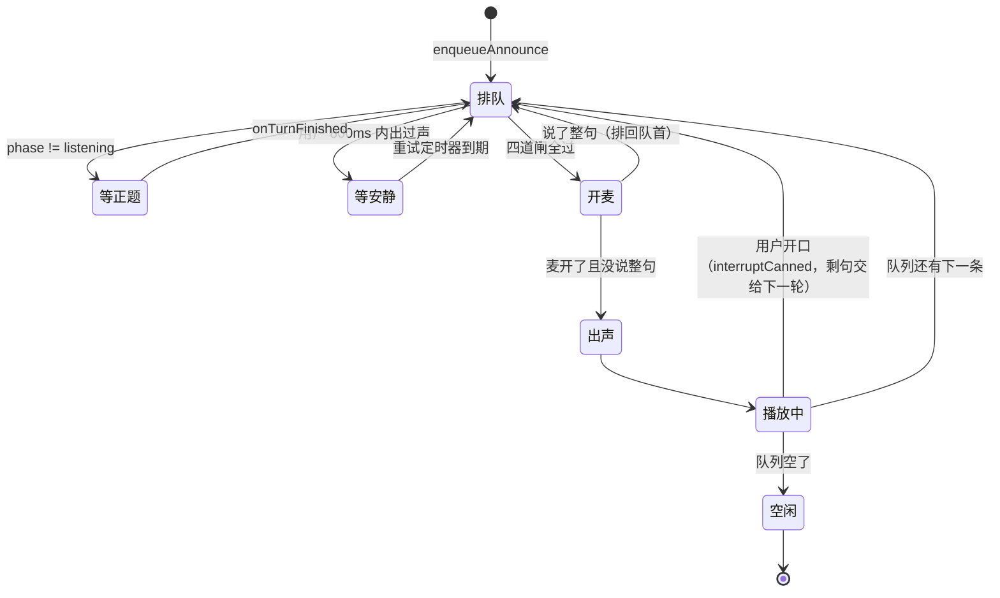

## 5.6 OmniShadow —— 音频直出车道

**持有**：`VoiceConnection.omni`（[`src/omni/shadow.ts`](../src/omni/shadow.ts) 的 `OmniShadow`，**按设备连接建、按连接销毁**）。
顶层 [`src/omni-shadow.ts`](../src/omni-shadow.ts) 只重导出这个类和它的选项 / 状态类型。
控制帧在 `src/omni/control-plane.ts`，上行账本在 `src/omni/uplink-ledger.ts`，
协议与 `DELEGATE_TOOL` 在 `src/omni/protocol.ts`，回复相位在 `src/omni/response.ts`，
套接字在 `src/omni/socket.ts`，共享类型在 `src/omni/types.ts`。
**驱动**：`UplinkPipeline` 发出 `onSpeechOpen(preroll)` 和统一的
`onFrame(frame: AudioFrame)`（`pcm` / `voiced` / `silenceMs` / `gateSeq` / `tsMs`）。
`UtteranceAssembler` 把封段拆开：`onCommit`（20 ms，`omni.seal`）与 `onSttCommit`
（150 ms，`stt.commit()`，用 `asr.commit.lane_seq` 配对）。认领与丢弃在
`LiveVoiceEngine`（`FastVoiceEngine.respond` 里面），不在 `TurnRunner`。

> **硬约束：`OMNI_ANSWER=full` 时，快车道每一轮都必须由 omni 答。**
> 一轮退回级联，用户就在同一段对话里听到两副嗓子。验收口径见本节末。
>
> **`VOICE_PIPELINE=live` 之后前台只有这一条。** 文本快车道不加载，后台结论经 §5.7
> 回到同一副嗓子，不再为了汇报退回另一条对话前端。本节的连接态、闭嘴、认领讲的是
> `origin: 'user'`。`origin: 'announce'` 不跟用户的 `next`，用户的 `claim()` 也不拿它。

### 状态

| 状态 | 含义 |
|---|---|
| `idle` | 还没建连（`assert` 之前的一切入口都是空操作） |
| `connecting` | socket 已发握手，等 `session.updated`（实测 ~1.3 s） |
| `ready` | 可发 `commit`+`create` |
| `busy` | 有一份 response 在生成（`resp !== null`） |
| `broken` | **吸收态，不自动重连**。`stop()` 与故障都经唯一的 `teardown()` |

| 事件 | 从 | 到 | 条件 / 副作用 |
|---|---|---|---|
| `start()` | `idle` | `connecting` | 与设备握手**并行**，不占关键路径。握手超时 15 s → `teardown` |
| `session.updated` | `connecting` | `ready` | 握手完成即就绪，**没有「预热 seal」**（发假音频会白花钱 + 往第 0 轮塞脏历史） |
| `seal()` | `ready` | `busy` | `commit` + `create` **连发**（pipe）。create 每推迟 1 ms 首块就晚 1 ms，决策预算只有 ~171 ms |
| `seal()` | `busy` | `busy` | 先 `response.cancel()`，把这一份排进 `pending`（只留一份），`done` 之后补发 |
| `response.done` | `busy` | `ready` | 同时 flush `pending`（→ `busy`）和排队中的回注 |
| `stop()` / 断线 / 协议错 / 30 s 看门狗 | 非 `broken` | `broken` | `teardown(reason, emitSkipped)`。已是 `broken` 则直接返回。30 s 只防挂死，不是性能判据 |

`teardown` 清掉定时器、socket、`resp`、`pending`、`claimReserved`、`claimedResp`、`held`，
再 `wakeAudio` / `wakeLive`。`stop()` 不写档案；故障路径落 `{skipped:'broken', why}`。
这条连接不重连，所以没有 `wsGen`；ASR / TTS 的 socket 代次在 §9。

`willServe()`、`canAnswerText()`、`canSpeakBackground()` 的第一行都要求
`state === 'ready' || state === 'busy'`。`broken` 三个都是 `false`，
`LiveOrchestrator` 因此走 `fallback_dsh`（§5.7），账本记 `dsh`。
`canAnswerText` 还要求此刻就是 `ready`、`resp` 与 `pending` 都空。
`canSpeakBackground` 在这之上再要求发声队列为空、并且 `dirtyBytes === 0`。

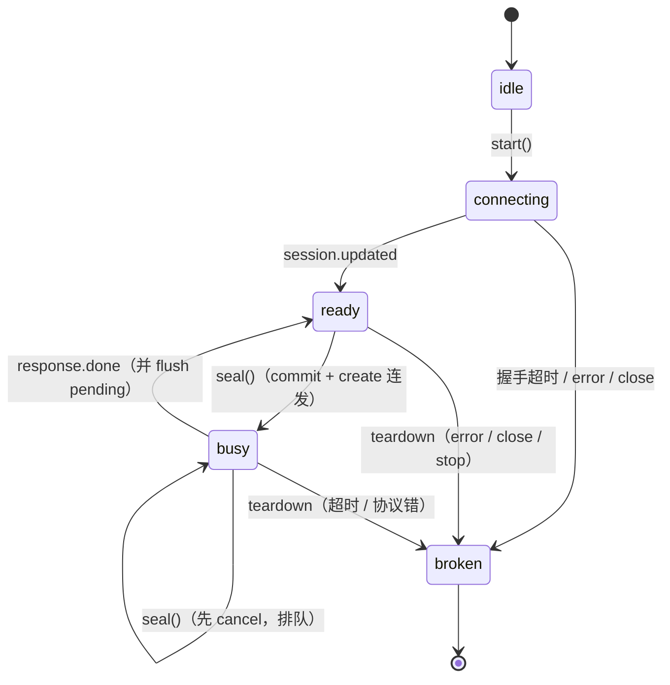

### 子状态一：闭嘴（`muted` + `ring`）

能量门 `holdMs`（2 s）比 `commitMs`（20 ms）长得多，所以**封段之后还会收到 ~2 s 静音**。

| 事件 | `muted` | 动作 |
|---|---|---|
| `seal()` | `true` | 之后一段都不往服务端推 |
| `feed(pcm, voiced=false)` | `true` | 只进 `ring`（上限 150 ms），**一个字节都不发** |
| `feed(pcm, voiced)` | `true` | `muted=false`，先补 `ring` 再追加（软起音不被切掉） |
| `feed(…)` | `false` | 直接追加 |
| `restart(preroll)` | `false` | 新一轮开口：cancel 上一份 → 清 `pending` → 有残留就 `commit`（**不发 create**）→ 补预卷 |

`voiced` 必须由能量门给（`EnergyGateDecision.voiced`），不能自己按能量重算 ——
两处门限一漂移就开始丢字或灌静音，而且从数据上分不出来。

### 子状态二：认领（谁拿走这一份）

| 字段 | 含义 |
|---|---|
| `resp` | 当前这一份（`response.done` 一到就置 `null`） |
| `pending` | 撞 busy 时排队的那一份（只留一份，`SealMeta` 钉住字节数） |
| `claimReserved` | 已经答应给某个消费者，但那一份还没建出来 |
| `claimedResp` | **认领落在哪一份上**（引用，不是事后去 `resp` 里找） |
| `readyResp` | 已经 `response.done`、还没人 `claim()` 的用户回复。TurnJudge 晚到几十毫秒时仍能把音频读走，避免退回 `answerFromText` |

两处容易写错：

1. **`willServe()` 必须看得见 `pending`，并且先看相位。** `broken` 直接 false。
   撞 busy 之后「cancel 掉旧的 + 新的排队」，
   而新的要等旧的 `done` 才建 —— 实测空窗 **92 ms**。只看 `resp` 会在这窗口里判 false，
   整轮退回级联，而 omni 那份 1 s 的回答生成完没人要（真机 2/38 中招）。
2. **`claimedResp` 不能省。** `finish()` 一到就把 `resp` 置 null，而异步 generator 的
   第一个 `next()` 是微任务 —— response 若在消费者开始读之前就 `done`，事后去 `resp` 里
   找只会得到 null，表现是静默等 5 s、零音频。
3. **并段轮里认领要顺着 `next` 跟到真正那份。** 一句话被切几段就几次 `seal()`，
   第一份会被下一段取消（`superseded`）；读端在一个字节都没播的情况下跟到 `next`，
   播过就停在那里（两段回答拼在一起更难听）。跨 `turnEpoch` 的 `next` 不许跟 ——
   那是下一轮的答案（`restart()` 每次 +1）。

### 与主链路的接缝（三处，各管一件事）

| 位置 | 做什么 |
|---|---|
| `voice-session` 接到的回调 | `onSpeechOpen` → `restart(preroll)`；`onFrame` → `feed(frame.pcm, frame.voiced)`；`onCommit`（20 ms）→ `seal(laneSeq, silenceMs)`；`onSttCommit`（150 ms）→ `stt.commit()`（`asr.commit.lane_seq` 配对） |
| `FrontedAgent` | `isPrefetchable()` 里压住投机（不压就是每轮双花 LLM 钱）；`reply()` 认领；`delegate()` 先 `discard()`（omni 已经说过垫话时它落空，见下）；`noteServedTurn()` 写回 `pending`；`injectAnsweredTurn()` 回注委派轮 |
| `TurnRunner` | 只 `for await` `FastVoiceEngine.respond()`。问 `willServeAudio`、认领、直出或流式，都在引擎里（`LiveVoiceEngine` / 级联泵 / `AgentEngineAdapter`）。首块仍在本类 `emit()` 里 `audioStarted` |

三种「不采纳」的语义**不能混**：

| 入口 | 取消 | 删半句 | 为什么 |
|---|:--:|:--:|---|
| `discard()`（走 dsh / 判据否决） | ✅ | ✅ | 一个字都没播 |
| `cancelCurrent()` 且 `!claimed`（同句第二次封段顶掉） | ✅ | ✅ | 那份答的是半句话，没人听过 |
| `interrupt()`（播到一半被插话） | ✅ | ❌ | 用户已经听到了一部分，删了就和 `pending` 里记的半句对不上 |

**第四种情况不在这个表里：委派轮（omni 说过垫话、dsh 在飞）撞上插话 → 谁也取消不了。**

`session/cancel` 只作废**下游输出**，上游的活儿照跑（真机实测：05:08:50 取消，
05:08:52 task-board 才报 `刚结束 bash「nproc; free -h」`）。所以取消省下的只是
最后那一步总结，丢掉的却是用户唯一能听到的那句话 —— 第 9、10 两轮都是这么死的：
dsh 答完了、一个字没播，用户只好重问一遍。

改成 **`detachTurn()`（放手）**：`ask` 立刻收成空答复（这一轮已经作废，不挂住状态机），
dsh 继续跑完；回来的答复交给 `setAnnouncer` —— 与「后台任务结算」同一口播报。
三条硬边界：

- **只在「委派前已经出过声」时才放手**（`receiptSpoken === true`，也就是 omni 说过垫话）。
  那一刻等于**承诺了答案**，得兑现；没出过声的轮次用户插话就是不要了，照旧取消。
- **认轮次用 `turn/end` 的轮号，不用 idle 计数。** `session.status` 只有
  `{sessionId, status}`，没有轮号；而「发了几条 prompt / 收了几条 idle」只要错一格
  （排队的 prompt 被 `outcome:canceled` 取消时压根不会有 turn、也就没有 idle），
  后面每一轮的答案都会交给错的人。`turn/start` / `turn/end` 的 `data.turn` 是
  单调递增的轮号，对得上才结算。
- **放手那一轮的 `idle` 不能唤醒新一轮**。`idle` 不带轮号，只能靠顺序：
  `turn/end` 一定先于同一轮的 `idle`，所以结算时打一个一次性标记把紧随其后的
  那条 idle 吃掉（下一轮 `turn/start` 一到就清掉，防止那条 idle 压根没发时误吃下一轮）。
- **答案回来时用户已经在问新问题**：不补播（会打断他），但**必须回注记忆** ——
  `onDetachedAnswer(userText, answer, spoken)` → `rememberDsh` + `injectAnsweredTurn`。
  跑完的活儿是真的，用户听没听到是另一回事；不记的话他之后提起这件事，
  两条车道都当没发生过。`spoken` 决定回注口径（"已经念过" vs "没来得及念"）。
- **只有显式下令才取消**：`turn-router.isCancelRequest()`（整句就是"算了/别查了/取消"
  那几个说法）→ `FrontedAgent.cancelRunningTask()` → `session/cancel`，**连已放手的轮
  一起取消**（`DshSession.cancelTurn` 认 `detached`，`isBusy()` 报有没有活儿）。
  插话 ≠ 取消，这两件事在真机上是完全不同的话术。

> **曾经漏了一整条路**：`FrontedAgent` 写的是 `this.inner.detachTurn?.(ticket)`，而
> `DshAgent` **从来没有实现 `detachTurn()`** —— 可选调用遇到 `undefined` 静默空转，
> "放手 / 回注"上线以来一次都没生效过。`keepalive.trackActivity` 现在用 `Proxy`
> 自动转发 `AgentProvider` 上的全部可选方法（`detachTurn` / `dshBusy` /
> `setDetachedAnswerSink` / `dropPrefetch` / `reconcileTurnOutcome` /
> `lastLedgerLane` 等），只有 `reply` 被包一层记账。

> **「用户听到多少」只有一处记着**：`playedSeconds`。`reply.text` / `reply.speech`
> 是**生成**进度（`response.audio_transcript` 累积），被打断时通常是全文。
> 服务端历史同样是全文 —— 两条轨在这一点上是一致的，只是都跟「听到的」不一致。
> `conversation.item.truncate` 实测**静默忽略**（见 `docs/OMNI-LANE.md` §5），
> 所以要对齐只能走 delete + `user` 回注。

**委派轮的第一声是 omni 自己出的**：工具描述里那句「调用之前先用一句话应一声」，
实测 **6/6** 生效（1.4–2.3 s），线序 `function_call_arguments` → `audio.delta` → `done`。
所以 `delegate()` 里那句 `discard()` 在这个形态下**落空**（`done` 已到、`resp` 已置 null），
那条领句不会被删 —— 正确，用户听过它。之后 `receiptSpoken:true` 让 `RECEIPTS` 闭嘴，
不会再叠一句别的声音。见 `docs/OMNI-LANE.md` §10.1。

**`interrupt()` 只动 `claimedResp`，不是 `this.resp`。** 插话的处理常常晚于下一段的封段：
那时 `this.resp` 已经是**新那句话**的回复了（旧的被 cancel、排队那份被 `done` 提升上来），
盲掐 `this.resp` 会把还没开口的新答案一起杀掉 —— 下一轮只能退回级联，用户听到换嗓子。
真机实测**每次插话都中招**（`20261122-200901` 的 TURN n=10 → n=11）。

`item.delete` 只能**延迟**到 `response.done`：要 item id，而 id 在
`response.done.response.output` 里（`assistantItemIds` 含助手项和 `function_call` 项），
discard 当场通常连 `created` 都没到。

### 子状态三：`readyResp` 与删项

`response.output_item.added` 且 `item.type === 'function_call'` 时立刻把 `delegate` 标成 `'delegate'`。
真服务上这条比首块音频早约 150 ms。守卫轮靠它在出声前知道已经委派。

`finish()` 把还没人认领、也没被取消的用户回复放进 `readyResp`，不进 orphans。
`demoteReadyResp(deleteUser)` 再把它降成孤儿：

| 调用 | `deleteUser` | 删什么 |
|---|---|---|
| `discard()`、同句再 `seal()`、`finish()` 顶掉上一份待认领槽 | `false` | 只删助手项。同句前半段用户音频留下 |
| `restart()`、`speakFromText()`、`answerFromText()`、`drainSpeechQueue()` | `true` | 助手项和用户项一起删。新一轮开口，或改走文本 / 播报 |

`deleteOnDone` 在 `finish()` 里按 id 删除。编排器若又 `deleteItems` 排了同一批 id，
`finish()` 把 `pendingDeletes` 里已经发过的拿掉。`deleteItems` 入队时也对空串和重复 id 去重。
同一 id 发两次会连着两条协议错误，车道进入 `broken`。

`flushReady` 的顺序：orphans → `pendingDeletes` → 工具回执 → 整份 `session.update` → 旧回注队列。

### 验收：怎么知道硬约束还成立

`agent.lane` 每次 `FrontedAgent.willServeAudio()` 落一条。`routeTurn()` 之后的格式是：

```text
{ has_lane, lane_ok, ok, lane, why, ...explain() }
```

`text_ok` 已经不在这张单子里。`src/fsm-trace.ts` 的 `isLaneFallback()` 认「该 omni 答却退回级联」：

- 新档案：`why === 'live-down'`，或者 `has_lane === true && lane_ok === false && lane !== 'dsh'`
- 旧档案（只有 `lane_ok` / `text_ok`）：仍是 `lane_ok:false && text_ok:true`

**这个数必须是 0。** 正常交给 dsh 的路由（`lane === 'dsh'`，以及旧档案里 `text_ok:false`）
不是违约 —— 那种轮次本来就不属于这条车道。`omni.shadow` 的 `cancelled`/`skipped`
另有口径（影子数据，不是接管）。

## 5.7 扁平 Pure Live —— 后台任务与播报投递

**持有**：每条任务的 `state` 在 `BackgroundTaskBus`；播报队列仍在
`DialogRuntime.announceQueue`；`origin: 'announce'` 那一份回复在 `OmniShadow`。
**驱动**：`LiveOrchestrator` 把 `tool_call` / `early_rule` / `image` /
`memory_silent` 收进总线，dsh 自己的 `onAnnounce` 走
`ingestExternalAnnouncement`；汇报经 `setTaskReporter` → `enqueueAnnounce` →
`flushAnnounce`。`VOICE_PIPELINE=cascade` 不走这一节。
`dispose()` 置 `disposed` 并停总线；之后 `respond` / `speakBackgroundReport` /
`finishLive` 的恢复点都直接返回。

### 前台决策 `decideLiveTurn`

`respond()` 开头把这一轮收成一张纯函数表，再 `switch`。穷尽，没有落在表外的分支。

| 事实（按这个顺序看） | 决策 | 做什么 |
|---|---|---|
| `isCancelRequest` 且 `hasActiveReportable()` | `cancel_bg` | `cancelAll('user_cancel')`，丢掉在途 omni，念取消句 |
| 本轮带图，且 `willServe()` 或 `canSpeakBackground()` | `photo_delegate` | `discard()`，派 `image`，念拍照垫话 |
| 带图但车道开不了口 | `fallback_dsh` | 同步 `inner.reply`，再排队让 omni 说；说不了就只留文本 |
| 问钟点，且 `willServe()` 或 `canAnswerText()` | `clock_override` | 立刻 `discard()`，当场 `dispatchEarly`（`early_rule`），前台只念垫话 |
| 问钟点但车道开不了口 | `fallback_dsh` | 同步 dsh，不经 omni |
| `willServe()` 或有 `answerFromText`，且 `isActionRequest` 或 `isRealtimeFactRequest` | `live_with_bg_guard` | 先让 omni 开口。条件假设里的天气（「如果…不下雨的话就…」且没有显式问天气）不算实时事实 |
| `willServe()` 或有 `answerFromText`，其余 | `live_direct` | `playLive`，没有可认领封段时改 `answerFromText` |
| 车道两个入口都没有 | `fallback_dsh` | 同步 dsh。`remember` 把车道写成 `'dsh'`，`lastLedgerLane()` 原样读出来（`pet` 仍当成没答过） |

`looksMemorable` 且决策不是 `cancel_bg` / `photo_delegate` 时，另派一条 `memory_silent`。
它不进 `turnNo` 去重，也不播报。

`live_with_bg_guard` **不在进 omni 之前派单**。工人晚一个微任务就会开跑，
提前派的 `early_rule` 会拿着 ASR 原话跑完，后面的改写查询赶不上。

| Omni 这一段里发生的事 | 派单 |
|---|---|
| 首块音频到达，守卫还开着，字节数仍是 0，`delegateReason()` 仍空 | `discard()`，0 字节外泄。`early_rule` 用原话，`meta.delegate: 'task'`，再排队短应声 |
| 事件流里出现 `delegate`（`output_item.added(function_call)` 可能比音频早约 150 ms） | 当场 `tool_call`。主查询是用户原话；`rewrittenQuery` 只在和原话不同时写进注记 |
| `done` 时还没见过 `delegate`，或流结束仍没有，且上面还没补过 | `dispatchEarly`：`source: 'early_rule'`，查询是原话 |
| `signal.aborted` 或 `disposed` | 不再补派 |

`live_direct` 里 omni 自己吐出 `delegate` 时，同一条 `finishLive` 也按 `tool_call` 派，
只是没有「没调工具就补 `early_rule`」这一步。整段结束、没调工具、也没被守卫接走时，
`detectSubjectHallucination`（`src/pipelines/entity-divergence.ts`）才看专名听岔。
命中就派 `early_rule`，注记要求 `[原意: …]`。它不看动作句和实时事实句，和守卫轮、
`DELEGATE_TOOL` 的专名描述不重叠。

### `LiveSessionStore`

**持有**：`LiveOrchestrator.state`（`src/pipelines/live-session-store.ts`）。
**驱动**：`reduceLiveSession(state, event)`。纯函数，没有 IO。同一串事件得到同一份状态和同一批意图。
编排器 `apply` 之后按意图调用车道：`sendFunctionCallOutput`、`deleteItems`、`updateDynamicContext`。
快照字符串没变就不发 `sync_omni_snapshot`。空快照是空串。

| 事件 | 状态 | 意图 |
|---|---|---|
| `lane.replaced` | `epoch++`。上一代 `pending` 投递改成 `dropped`。旧 item id 清掉。在途任务不改成 `cancelled` | 无。新连接上删不到旧 id |
| `turn.delegated` | 记下任务和这一轮的工具 id | 有 `call_id` 就 `send_tool_output`：`accepted_running`，`executed: false` |
| `turn.early_guarded` | 记 `early_rule`。未核实助手项只清一次（`unverifiedReplyCleared`） | `delete_omni_items`。同句用户音频不在这张单子里 |
| `turn.recorded` | 写入 `assistantSpoken` 和 `lane`。有正文才更新 `lastAnsweredLane` | 快照若变了就同步 |
| `turn.reconciled` | 只改票据完全相同的最后一条的 `truncated` | 对不上就连序号都不动 |
| `task.lifecycle` | `queued` / `running` / `cancelled`。`upgraded` 只改还在 `queued` 的查询。终态不再回到排队 | 无 |
| `task.cancelled_all` | 要播报的 `queued` / `running` 进 `cancelled`，投递改 `dropped`。静默任务不动 | 无 |
| `task.completed` | 终态不可逆。取消之后迟到的成功丢掉 | 非静默则 `deliver_report`。`[原意]` 和 ASR 不同时，把 `canonicalUser` 写进轮次；界面纠偏附在这份汇报上，不另发 |
| `task.failed` | 同样不可逆 | 非静默则 `deliver_report` |
| `announce.settled` | `spoken` 或 `interrupted` | 快照里的「已口头告知 / 播报被打断」变了才刷新单槽 |

任务执行态与总线那一节相同：`queued` → `running` → `completed` / `failed` / `cancelled`。
`[原意: …]` 由 `background-task-bus.ts` 从结论第一行剥下来，写进 `canonicalUser`。
快照里的纠偏行是「已核实说法：第 N 轮「原转写」→「原意」」。静默记忆不进这份快照。

总线上「排队中的 `early_rule` 可被后到的 `tool_call` 升级」仍然有效
（`clock_override` 就是进 omni 之前就派了 `early_rule`）。守卫轮自己不会在同一同步回合里先派粗查询。

### 每条后台任务

合法转移只有这些。`completed` / `failed` / `cancelled` 是终态。取消或
`dispose` 之后 runner 才回来的结果**不再**发 `BackgroundTaskReport`。

| 从 | 到 | 何时 |
|---|---|---|
| `queued` | `running` | 工人循环取到它。一次只跑一个 `execute` |
| `queued` | `cancelled` | `cancelAll`，或 `dispose` |
| `running` | `completed` | `execute` 成功，且取结果时状态仍是 `running` |
| `running` | `failed` | `execute` 抛错，且当时仍是 `running`。要播报的任务给一句兜底，不把异常原文念出去 |
| `running` | `cancelled` | `cancelAll` 停掉正在跑的那条（要播报的才算）；`dispose` 只 abort 信号，**不**调用 `cancelRunning` |

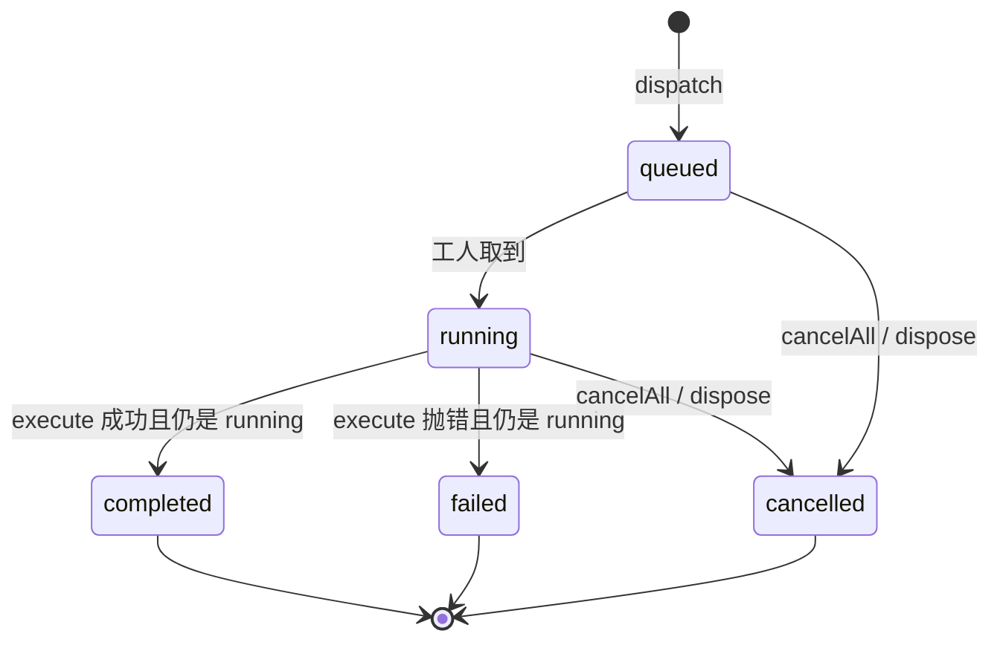

工人循环晚一个微任务才取队列。去重键是 `turnNo`，只对要播报的任务。
守卫轮不靠「同一回合里先粗后细」：`tool_call` 在 `delegate` 到达时才派，
`early_rule` 只在整段结束仍没有 `delegate` 时补上（见上一节）。
下面这张升级表留给确实会先入队 `early_rule` 的路径（例如 `clock_override`）：

| 规则 | 行为 |
|---|---|
| 同一 `turnNo` 已在 `queued` / `running` / `completed` | 第二次 `dispatch` 记成去重，不再开一条 |
| 已在 `queued`，新来的是 `tool_call` | **升级查询**（以及带了的 `note`）。`early_rule` 不能把已经是 `tool_call` 的查询改回去 |
| 已是 `running` 或 `completed` | 不升级。这一轮已经在跑或跑完 |
| `failed` / `cancelled` | 摘掉这张 `turnNo` 表，同一轮可以再派 |
| `memory_silent`（或 `silent: true`） | **不参与** `turnNo` 去重。单独排在 `silentQueue`，工人先排空要播报的队列再取它。成功和失败都不发汇报。`cancelAll` 默认留着它，只有 `includeSilent` 才一起停 |

`image` 与 `tool_call` / `early_rule` 一样要汇报。dsh 内部
`run_in_background` / 子代理跑完的 `onAnnounce` **不进这条队列**（那边已经执行完），
`ingestExternalAnnouncement` 直接收成 `source: 'dsh_background'` 的
`BackgroundTaskReport`，后面仍走同一条播报投递。

插话和取消是两件事：

| 事件 | 总线 |
|---|---|
| 前台插话（`cancelTurn` / `abortSpeculation('barge_in')`） | **不取消**。`cancelTurn` 只在同步兜底那一次 `inner.reply` 还在等时，才把取消转进那一次 dsh。已经派进总线的任务继续跑，结果仍要说 |
| 显式 `isCancelRequest`（整句就是「算了 / 别查了 / 取消」那几个说法）且 `hasActiveReportable()` | `cancelAll('user_cancel')`：停掉排队的和正在跑的**要播报**任务。`memory_silent` 不动 |
| 取消或 `dispose` 之后 runner 才 resolve / reject | 状态已经离开 `running`，`finishOk` / `finishErr` 直接返回。不发汇报，失败也不会再变成兜底句 |

已经 `deliver` 进播报队列的汇报不由 `cancelAll` 撤回。没念出去的抑制发生在
「还没变成 `BackgroundTaskReport`」这一侧。

### `origin: 'announce'` 与 `flushAnnounce`

汇报进了 `announceQueue` 之后，§5.5 的四道闸先过。过了之后，Pure Live 的开口是
一台单独的投递机。`FloorArbiter` 这边：`phase === 'listening'` 时 `reply` 已释放，
`announce` 才占得上话筒（它抢不动 `reply`）；宠物看到 `announcePending` 就不再自己开口。
omni 这边再加一道空闲闸，空闲的定义是 `canSpeakBackground()`，要同时成立：
`serve !== 'off'`、`state === 'ready'`、`resp` 与 `pending` 都空、发声队列为空、`dirtyBytes === 0`。
差一条就在忙时 `response.create`，服务端会拒并且那一次 create 丢失。

`flushAnnounce` 见到 `verbatim !== true` 且挂了 `speakAnnounce` 时，把结果收成三态
（`LiveOrchestrator.speakBackgroundReport`）：

| 结果 | 条件 | 然后 |
|---|---|---|
| `spoken` | `canSpeakBackground()` 为真，`enqueueSpeech` 或 `speakFromText` 非 null，并且播过字节，或 0 字节但是被打断 | `announce.settled` 写成 `spoken` 或 `interrupted`，单槽快照跟着变。真车道不再 `injectAnswer` |
| `defer` | 还没开口就 `disposed`、车道不空闲，或 `speakFromText` 返回 null；开口后 0 字节且已经 `disposed` 也走这里 | **排回队首**，不 `markInjected`。`finally` 再排一个 800 ms 重试 |
| `fallback` | 车道没有 `enqueueSpeech` / `speakFromText`，或开口后 0 字节且不是打断 | `allowTtsFallback !== false` 时 `speakCanned`。`VOICE_PIPELINE=live` 关掉这个开关：只展示文字。`noteFallbackAnnounceSpoken` 在真车道上只记 `announce.settled`；没有 `updateDynamicContext` 的假车道、且没被打断，才 `injectAnswer(..., 'spoken')` |

`needsVerbatimRead` 仍给报告带上 `verbatim`（显式逐字标记、长数字、IPv4、订单号、
带目录分隔符的代码路径、超过 180 个码点）和截到 160 个码点的 `summary`。
`VOICE_PIPELINE=live` 时 `allowTtsFallback` 为 false：`verbatim` 也进 `speakAnnounce`，
由 omni 念，不调用 `speakCanned`。只有这个开关还开着的旧路径，才在 `verbatim` 时跳过
`speakAnnounce`、直接 `speakCanned`。

用户在安静窗到来之前先开口：真车道的未播结论已经在单槽里，`flushUnspoken` 直接返回。
没有 `updateDynamicContext` 的假车道才把每条未播结论 `injectAnswer(..., 'unspoken')` 一次。

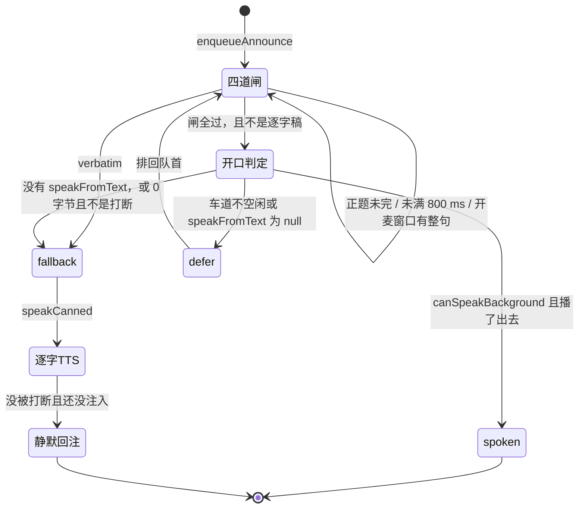

上图是 `allowTtsFallback` 仍为 true 的旧投递：`verbatim` 直接 `speakCanned`，
静默回注才 `injectAnswer`。`VOICE_PIPELINE=live` 把这个开关关掉，`verbatim` 也走
`开口判定`，fallback 只展示文字，不进「逐字TTS」。

`speakFromText` 开出来的那份回复 `origin` 固定是 `'announce'`，读端**只绑这一份**：

| 隔离 | 规则 |
|---|---|
| 不追用户的 `next` | 音频迭代停在自己的 `cancelled` / `closed` 上。`target.next` 是用户下一段封段，读了就把用户的音频抢走 |
| 用户的 `claim()` 不拿它 | `liveResp()` 见 `origin === 'announce'` 直接当没有。并段跟读只发生在用户那一份上 |
| 0 字节被打断 | `cancelBackgroundSpeech` → `outBytes === 0` 时标 `deleteOnDone`，done 时删助手项和 `function_call` 项。临时 prompt 的 user 项由 `deletePromptUserOnDone` 删掉（出过声的助手项仍留着）。这不是用户真话，不留给下一轮指代 |
| 已经出过声再被打断 | 不标 `deleteOnDone`，助手项留着，与 `interrupt()` 同一口径：用户听过的半句不能从历史上抹掉 |
| 不进 `omni.shadow` | `origin === 'announce'` 的 `response.done` 不发封段事件，避免被当成一次用户开口 |

播报期间 FSM 停在 `listening`，`bargeIn()` 对它不成立。掐断的唯一入口仍是
`DialogRuntime.dispatch` 里对非旧段、非纯语气词的 `partial` / `sentence` /
`utterance`：`interruptCanned()` → `cancelAnnounce()` → `cancelBackgroundSpeech()`。
一个字节都还没出去就走上面的 `deleteOnDone`；已经出声则助手项保留。

## 5.8 怎么验证状态轮转真的对

上面每节写的「转移条件」，代码里对不对不能靠读 —— 跑一场，看档案：

```bash
node --experimental-strip-types scripts/fsm-trace-check.ts <档案目录 | events.jsonl>
```

审计器在 [`src/fsm-trace.ts`](../src/fsm-trace.ts)，判据全部来自本文件与代码里的既有事实：

| 规则 | 违反时的意思 |
|---|---|
| `turn.nested` / `turn.orphanEnd` / `turn.unclosed` | 串行队列漏了，或者某轮被丢下 |
| `state.whitelist` | 有人绕过 `transition` 改状态，或转移表被改动 |
| `state.afterClose` | `closed` 之后还有活的东西在跑 |
| `state.audioBeforeSpeaking` | 先出声后进 `speaking`（插话窗口会错位） |
| `state.turnCovered` | 一轮里没见过 `thinking`/`speaking`（通知链断了，就是 P0-1 那类） |
| `state.settledAfterTurn` | 一轮结束后没落回 `listening`/`ending` |
| `barge.noAudioStop` | 被判插话却没发 `audio.stop`（喇叭停不下来） |
| `turn.tooLong` / `timing.stopToFirst` | 挂住，或者用户等太久 |
| `lane.fallback` | `isLaneFallback()`：`why === 'live-down'`，或 `has_lane === true && lane_ok === false && lane !== 'dsh'`；`lane_ok:false && text_ok:true` 只用于旧档案 —— 该 omni 答却退回级联，**用户会听到两副嗓子**（§5.6） |

状态事件来自 `dialog.state`（`DialogRuntime.notifyState` 落档）。**老档案没有这个事件**时，
状态那几条记「缺仪表」跳过 —— 与 `latency-report` 的 `null` 口径一致，不拿「没记录」冒充「没问题」。

## 5.9 确定性内核 —— 判定层是一台纯 Mealy 机

前面每节都是"哪台机器持有什么状态"。这一节是**它们共同的判定层**：
[`src/kernel.ts`](../src/kernel.ts) 的 `step(state, event) → [state, effects]`。
文件里没有 `await`、没有定时器、没有 socket —— 所以同一串事件在任何机器上 reduce 出
完全一致的结果（`scripts/kernel-replay.ts` 就是它的离线执行体）。

四个**正交区域**（Harel orthogonal regions），跨区只通过带因果戳的事件、只读对方快照：

| 区域 | 回答什么 | 尺子 |
|:--|:--|:--|
| `input` | 这一句说完没、解码在不在途 | 逻辑因果（`commitSeq`） |
| `dialog` | 话筒主权在谁手上 | 逻辑因果（票据 `no`/`gen`） |
| `playback` | 声音播到哪了 | **媒体时间**（字节/采样率） |
| `ledger` | 谁答过、答的什么 | — |

三条交互律（违反任何一条都会回到"灵异 bug"）：

1. **事件自带出生证**：跨异步边界发出的请求出发时盖上 `commitSeq`/票据，结果回来原样带回。
   `isCausallyStale()` / `isPreTurnCommit()`（定义在 [`src/kernel.ts`](../src/kernel.ts)，
   底层序号判据在 [`src/causal.ts`](../src/causal.ts) 的 `isPreTurnSegment`）是所有转移前的统一守门人。
2. **控制权与物理结算拆权**：`stale`（票据被顶掉，瞬时）归 `dialog`；
   `truncated`（少听了，后验）归 `playback`。两者分属不同区域，
   所以「播完瞬间被新轮顶掉」不会互相打架。
3. **跨区只读快照**：判打断只比 `event.commitSeq > dialog.ticket.baseCommitSeq`，
   不回头问 ASR「你是不是还在解」。

边界（**现状**，别搞混）：`step()` 按正交区域拆成 `stepInput` / `stepPlayback` /
`stepDialog`，自己只做因果屏障、吸收态守门和按区域路由。只有 `stepDialog` 改 `dialog.phase`；
`turnEnded` 落在 `stepPlayback`，已结算过的那一轮只原样重述。相位真相在 `dialog` 区域，
`KernelRuntime` 持有**唯一一份** `KernelState`。`DialogRuntime` 用 `attachPorts()` 绑上
生产 `KernelPorts`；`DialogFsm` 与 `TurnRunner` 都经 `dispatchAndApply()` 执行意图，
四条（`stopDeviceAudio` / `invalidateTurn` / `abortEngine` / `settleTurn`）**只跑一次**。
`KernelPorts.settleTurn` 把播完才知道的 `truncated` 与 `endedAtMs` 按 `{no, gen}` 票据
写进 `FrontedAgent` 的账本（`ConversationLedger.reconcileOutcome`）；重连用
`agent.lastLedgerLane()` 播种 `initialKernelState`。`DialogFsm` 仍是薄门面（翻译事件、
读 `runtime.state.dialog`）。`TurnRunner` 仍然 `await` 引擎事件和播放，但它**不再自己算账**，
也不再持有一份私有内核，也不再在 `run()` 里分 `omni` / `stream` / `pump`。出话只有一条泵：
构造时定下的 `FastVoiceEngine`，`run()` 只 `for await` 它的 `respond()`。生产由
`VOICE_PIPELINE` 二选一注入 —— `live` 是 `LiveOrchestrator.toEngine()`（omni 音频经
`LiveVoiceEngine`），`cascade` 是 `CascadeAgent.toEngine()`（同一份 `FastVoiceEngine`
契约；`CascadeVoiceEngine` 是这条约定的端口化实现）。没注入引擎的旧装配由
`AgentEngineAdapter` 把 `{ agent, tts }` 收成同一条 `respond()`。逐轮延迟埋点
（`tts.first` / `turn.end` 的 `dsh_ms` / `audio_s`）仍在 `TurnRunner`：引擎只报事实。
见 [ADR-0004](adr/0004-flattened-pipelines.md)。

**已知的一次真实事故**：打断那一刻内核就结算了那一轮（用户听到多少是后验事实，
清了播放区就没了），而那条 `async` 协程还会跑到尾巴再报一次 `turnEnded`。
不幂等的话，"少听了一半"会被重算成"听了 0 秒、没少听" → 该吞的答案反而被回注。
现在 `turnEnded` 发现这一轮已结算就**原样重述**同一份结算。

## 6 一轮对话的完整时序

> **泵已经收成一条（2026-11-23）。** 下面主图里的「投机双轨 / 快车道 / TTS」是
> **cascade 引擎内部**的事，`TurnRunner` 只消费 `EngineEvent`。`live` 不走这张双轨，
> 见 §5.7 与分支 C。分支 C 里的 `willServeAudio` / `claim` 发生在 `LiveVoiceEngine`，
> 不在 `TurnRunner`。

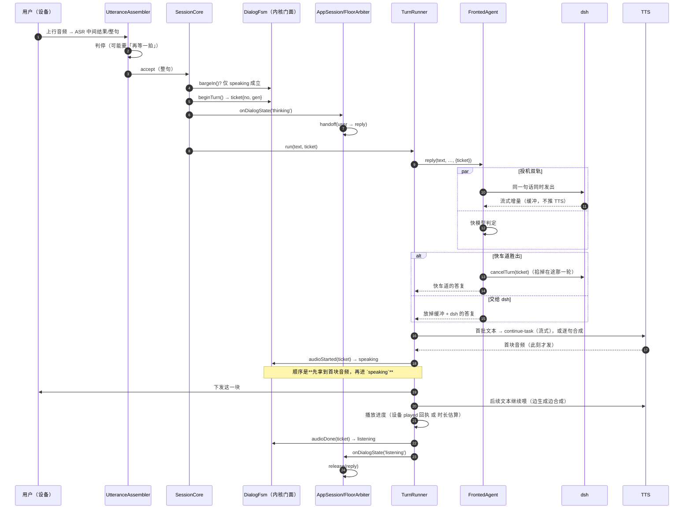

> **`audioStarted` 的位置别画错**（2026-11-19 核对）：它在 `turn-runner.ts` 的 `emit()`
> 里，紧挨着 `downlink.sendAudio()` —— 也就是**首块音频真要下发的那一刻**，不是回复
> 文本到达时。`fsm-trace.ts` 的审计规则「`tts.first` 必须落在本轮、且在 `speaking`
> 之后」就是靠这个顺序成立的。
>
> 一张画早了的图会让人以为「进入 `speaking` 到出声之间有 380 ms 空窗、吸收窗口因此
> 缩水」——**不成立**。那张图如果真搬到代码里，`speaking` 就会在用户听不见东西的时候
> 成立，插话窗口反而错位。

### 分支 A：用户插话

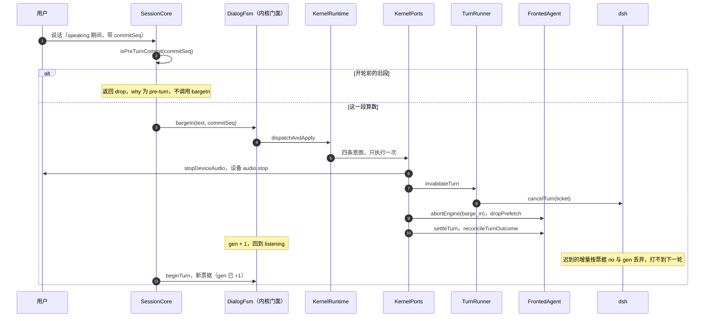

### 分支 B：快车道胜出

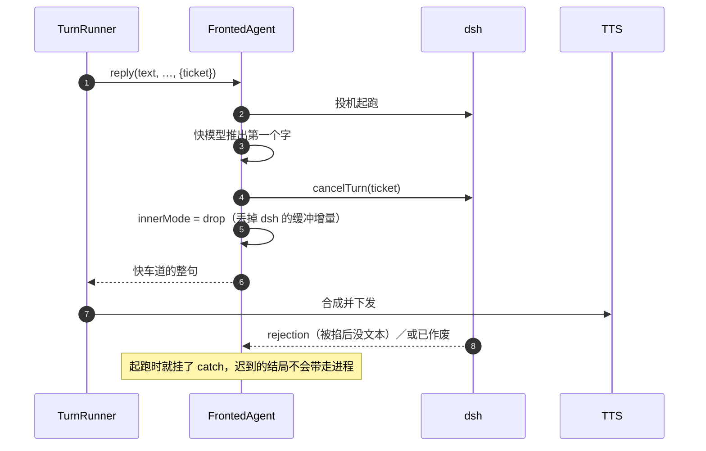

### 分支 C：omni 直出（`OMNI_ANSWER=full` / `VOICE_PIPELINE=live`）

omni **不等定稿**：封段在 `onCommit`（20 ms）先跑，早于 `onSttCommit`（150 ms）的 `stt.commit()`，用 `asr.commit.lane_seq` 配对。
图里的 `willServeAudio` / `claim` 是这条车道的时序；调用点在 `LiveVoiceEngine`，`TurnRunner` 只收 `EngineEvent`。Pure Live 这一轮走哪条分支由 `decideLiveTurn` 决定（§5.7），不在 `TurnRunner` 里再分一次。后台结论的开口也见 §5.7。

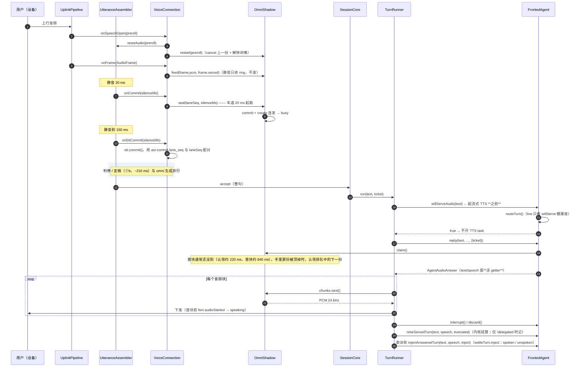

三条与 §6 主图不同的地方，都是有意的：

| 差异 | 为什么 |
|---|---|
| omni 在 `onCommit` 起跑，早于 `beginTurn()` | 推迟 241 ms 到定稿才 `create`，首块从 664 掉到 887，输给级联的 835 |
| `willServeAudio()` 在流式 TTS 之前问 | 那一步会真开一个合成 task，而 omni 轮没文本可送，服务端拒空文本 → 整轮退化 |
| `speech` 在 drain 之后才读 | 它是活 getter；被打断时当前值正好是「已播出去的部分」，审计与续话要的就是它 |

## 7 DshSession —— 进程代次与主轮相位

**持有**：`DshSession`（`src/session.ts`）。进程机和轮次机正交：`procGen` 管子进程，
`turnPhase` 管主会话这一轮。

### 轮次 `DshTurnPhase`

| 状态 | 含义 |
|---|---|
| `idle` | 没有在等的主轮，也没有放手后还在跑的委派轮。`isBusy()` 为假 |
| `prompting_rpc` | 正在等 `session/prompt` 的响应 |
| `awaiting_idle` | prompt 已被接受，在等这条主会话的 `idle` |
| `detached_running` | 调用方已经 `detachTurn`，dsh 那一轮还在跑 |

`askSdk` 从写 `activeTicket` / `onIdle` / `turnPhase` **之前**进入 `try`。
`finally` 清掉等待者和票据，相位落到 `detached ? detached_running : idle`。
`session/prompt` 抛错不会把 `isBusy()` 锁死。

`detachTurn(ticket)` / 取消侧的票据核对：`activeTicket === null`，或 `{no, gen}` 对不上，
直接丢掉。放手轮的文本在 `detachedText`，和下一轮的 `assistantText` 分开。
`turn/end` 对上 `detachedTurn` 时，若相位还是 `detached_running` 就回到 `idle`；
新一轮已经在 `prompting_rpc` / `awaiting_idle` 时不动它。

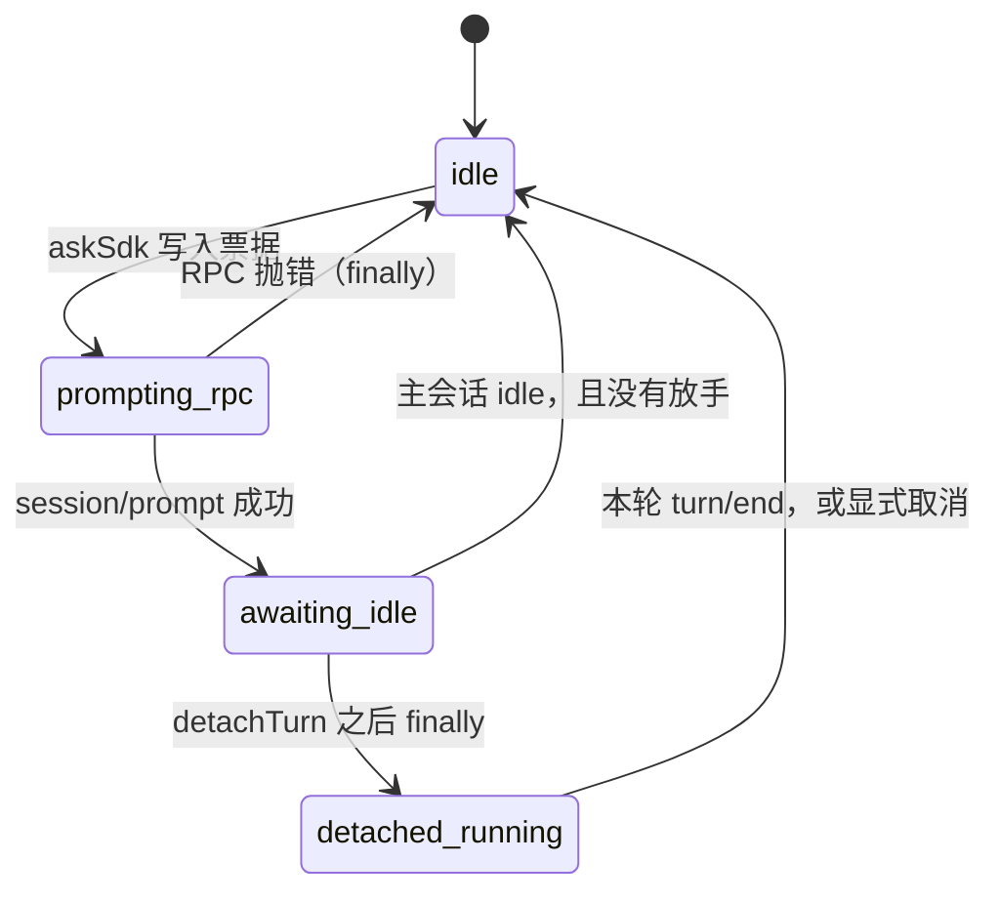

### `tailSwallow`

`idle` 不带轮号。上一轮的尾巴用三态挡住，避免叫醒新一轮的 `onIdle`，
也避免旧 `assistant/message` 写进新一轮：

| 相位 | 何时进入 | 下一步 |
|---|---|---|
| `none` | 没有旧尾巴 | — |
| `awaiting_old_turn_start` | `askSdk` 时自发轮还活着，而且旧 `turn/start` 还没到 | 吃掉那条 `turn/start`，改成 `awaiting_old_idle` |
| `awaiting_old_idle` | 旧 `turn/start` 已过（含放手轮刚 `turn/end`） | 吃掉紧随的那条 `status=idle`，回到 `none`。其间若先来了新的 `turn/start`，说明旧 `idle` 不会来了，直接 `none`。两条吞噬相位见到 `idle` 都回到 `none` |

`tailSwallow !== 'none'` 时，主轮的 `assistant/message` 不写入 `assistantText`。

### `procGen` 与 `openSessionId`

每次 `handshake` spawn 时 `procGen++`，`close` / `error` / `stop()` 的 2 s 强杀都抓住自己那一代。
`myGen !== procGen` 就返回：不 reject 新进程的 pending，不写新的 `exitError`，也不 `kill` 新进程。

`isMainSession` 要求事件上的 `sessionId` 非空且等于 `openSessionId`。
`session.event` 先喂 `TaskBoard`，对不上主会话就返回：不写 `assistantText`，不推 `turn/start` / `turn/end`。
`session.status` 同样先过这道门，子会话的 `idle` 不唤醒主轮。

## 8 VoiceConnection —— 开麦 `MicPhase`

**持有**：`VoiceConnection`（`src/voice-session.ts`）。唯一写入点是 `enterMic`。
非法迁移打日志并保持原状。每次真正迁出一格，`micEpoch++`。宽限定时器和等麦超时抓住登记时的代次。

| 状态 | 含义 |
|---|---|
| `idle` | 还没开始等设备推流 |
| `watching` | `armCaptureWatch` 已武装，宽限期内看设备是不是已经在采集 |
| `opening` | `listen.start` **已经发出去**，在等首帧 |
| `open` | 看到了非空上行音频 |
| `closed` | 吸收态。`onClose` 进入，等麦的人一律 `false` |

`canEnterMic`：任意状态都可以进 `closed`；`closed` 不能再出去。
`idle → watching | opening`，`watching → opening | open`，`opening → open | idle`，
`open → opening`。宽限到期但不该唤醒时留在 `watching`，不另开一条回 `idle` 的边。

`sendListenStart` 只负责调用 `sendCall`。`listen.start` 的字节真交出去之后，
`noteListenSent` 才 `enterMic('opening')`。发送失败留在原相位。
`listen.stop` 成功且当时是 `opening` 才回到 `idle`，并放开等麦的人。
`closing`（`linkClosing`）或连接已关时，`listenStartBlocked` 拒绝再发 `listen.start`。

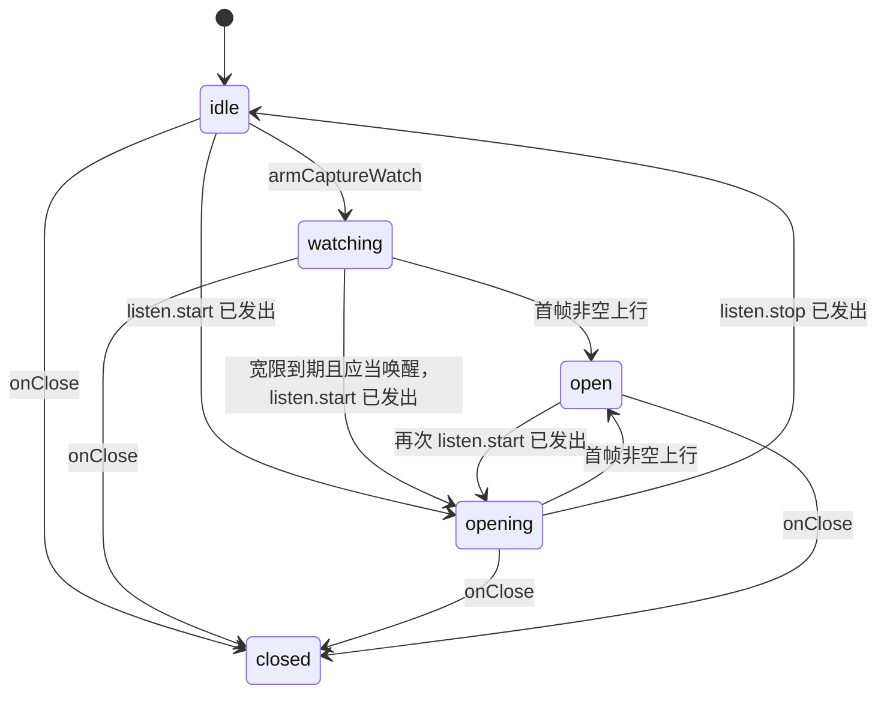

## 9 ASR / TTS —— `wsGen`

`QwenRealtimeAsr`、`AliyunAsr`、`OmniTts` 各自持有 `wsGen`。
`connect` 时先 `++wsGen` 并记住 `myGen`；`open` / `message` / `close` / `error`
以及 `await` 之后的第一行都核对 `myGen === wsGen`（再加「是不是这一条 socket」）。
对不上就返回，必要时把那条旧 socket 关掉。

`close()` 与 `drop()` 都再 `++wsGen`，让还挂在建连 `await` 上的那一次失效。
Qwen 的 `drop` 与 `close` 共用 `resetSessionState`：清 `dirty`、`awaitingDecode`、
`pendingVoice`、`holdActive`、`commitDeferred`、`commitWhenReady`、`discardLeft`、
积压缓冲，并 `resolveDecode()`，`whenDecoded()` 不会一直挂着。
未就绪时 Qwen 的 `backlog` 是 `{ pcm, voiced }`，`session.updated` 置就绪后按 FIFO 补发。
Aliyun 的积压是裸 PCM；`TranscriptionStarted` 里先按到达顺序刷完，再把 `ready` 置上。

`OmniShadow` 不在这张表里：它的吸收态是 `broken`，清理只走 `teardown()`（§5.6）。

## 10 浏览器 VoiceClient —— `ClientPhase` + `startGen`

**持有**：`packages/dsh-voice-web` 的 `createVoiceClient`。清理只有 `teardown(emitClose)`。

| 状态 | 含义 |
|---|---|
| `idle` | 还没 `start` |
| `starting` | 正在 `resume` / `getUserMedia`。这一次的 `startGen` 已加一 |
| `connecting` | 媒体就绪，WebSocket 还没 `open` |
| `open` | Hello 已发出，可以上下行 |
| `closed` | 吸收态。`start()` 再调用直接抛错，要换一个实例 |

`teardown` 在已经是 `closed` 时返回。否则：相位写成 `closed`，`startGen++`，
停采集、停播放、摘掉 socket 监听并关闭，关掉 `AudioContext`。
`emitClose === true` 时只发一次 `close`（页面自己的结束按钮传 `false`，避免和 `onclose` 套娃）。
`FrameDecoder` 超长、`onerror`、`onclose` 都进这一个入口。

`start()` 在每次 `await` 之后看 `phase === 'starting' && myGen === startGen`。
对不上就停掉这次才拿到的麦和 context，然后返回。`closed` 之后 `send` 与下行帧都丢弃。

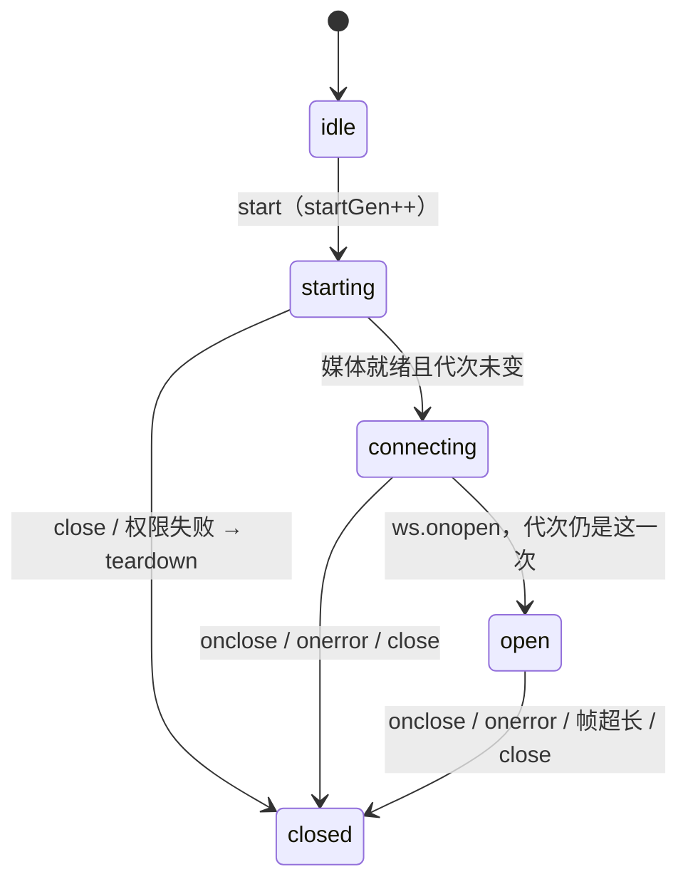

## 11 不变量

这些是上面几台机器在当前代码里守着的边界。序号与重构验收单对齐。

| 编号 | 代码里怎么守 |
|---|---|
| **INV-1** | `evaluate` / `rearmFromSpeakingMore` 每次 `await` 之后走 `isStaleEval`。期间有过 `onVoiced` 则 `evalEpoch` 已加一，旧协程退出，不 `flush` |
| **INV-2** | 生产帧的 `voiced` / `silenceMs` 只来自 `EnergyGate`（`voiceDebounceFrames: 2`）。`addFrame` 把同一份交给 `SilenceTriggers`。`speculateMs` 与封段门槛显式 `≤ 0` 时关闭 |
| **INV-3** | 只有 `stepDialog` 改 `dialog.phase`。`turnEnded` 只结算播放区与账本。`receiptEnded` 对过期票是空操作 |
| **INV-4** | 内核 `isStaleTicket` / `ticketMatches` 同时比 `no` 与 `gen`。`TurnRunner.isTurnDead` 把 `DialogFsm.isStale`（只比 `gen`）和 `isCurrent`（只比 `no`）合在一起 |
| **INV-5** | `UplinkPipeline.closed`、`UtteranceAssembler.disposed`、`MicPhase.closed`、`PhotoInbox.disposed`、`OmniShadow.broken`、`VoiceClient.closed`、`LiveOrchestrator.disposed` 进入后不再接新帧、新定时器或新一轮 |
| **INV-6** | `OmniShadow` 离开 `ready`/`busy` 后，`willServe` / `canAnswerText` / `canSpeakBackground` 为假。下一轮 `decideLiveTurn` 落到 `fallback_dsh`，账本车道是 `dsh` |
| **INV-7** | Qwen / Aliyun / OmniTts 的旧 socket 回调被 `wsGen` 挡住。Qwen `resetSessionState` 解开 `whenDecoded`，积压按 FIFO 补发并保留 `voiced` |
| **INV-8** | 子会话事件过不了 `openSessionId`。旧 `procGen` 的退出不碰新进程。`askSdk` 的 `finally` 把相位归回 `idle` 或 `detached_running`。过期票据的 `detachTurn` 是空操作。`tailSwallow` 吃掉旧轮那条不带轮号的 `idle` |
| **INV-9** | `live_with_bg_guard` 在首块音频前没有 `delegate` 就 `discard` 并补 `early_rule`；已经标了 `delegate` 才派 `tool_call`，主查询是用户原话。`announce.settled` 在 `playAudio` 确认说出或被打断之后才写。真车道用单槽快照，不靠 `injectAnswer` 堆结论 |
| **INV-10** | 话筒只写在 `AppSession.floor`。宠物经 `acquireFloor` / `releaseFloor` 看到同一份。`DialogRuntime.dispose` 取消旁白并 `photos.dispose`；`onClose` 先把开麦收成 `closed` |
| **INV-11** | 生产上行只在 `VoiceConnection` 构造管道时传入 `voiceDebounceFrames: 2`。能量门自己的缺省仍是 1，给不走这条装配的调用方。`assemblerSilenceFromGate` 把配置里的 `0` 原样传下去 |
| **INV-12** | `appendToken` 只把 `ENOENT` 当成空表，其它读失败原样抛出。帧超长、连接错误、主动关闭都进 `VoiceClient.teardown` 一次 |

## 12 插件启动与桌宠（索引）

语音栈仍是仓根那一套。下面只索引 `packages/dsh-voice-web` 里两台小机器，转移细节以源码为准。

**启动**（`src/driver.ts` 的 `apply`，相位在 `src/driver-policy.ts`）：

| 机器 | 状态 | 转移 |
|---|---|---|
| `HostPhase` | `discovering` / `host` / `standalone` / `stopped` | 只有 `discovering` 能进 `host` 或 `standalone`。卸载从任意相位进 `stopped`。晚到的 `webServer` 不能把已经退回独立桥的进程再挂一次 |
| `StackPhase` | `waiting` / `booting` / `up` / `stopped` | `boot` 只从 `waiting` 进入 `booting`。`booted` 在 `booting` 时留下 `release`；若当时已经 `stopped`，这份 `release` 立刻执行 |
| `VoiceBackendState` | `starting` / `ready` / `failed` / `stopped` | 面板上的 `voiceReady` / `voiceError` / `pipelineMode` 只从这一份派生 |

`bootVoiceStack`（`src/boot-voice-stack.ts`）在栈起来时调用同步副本里的 `loadSharedVad`。
模型缺失或加载失败退回能量门，不阻断插件启动。`mode: 'host'` 先挂桌宠 UI，不等语音栈预热完。

**桌宠**没有单独的 `src/pet/` 目录，都在 `src/browser/pet-*.ts`：

| 文件 | 状态 |
|---|---|
| `pet-sprites.ts` | `SpritePhase`：`idle` / `listening` / `thinking` / `speaking`。选图顺序是说话、倾听、预览、保持中的情绪，其余是 `calm`。`thinking` 没有自己的图。情绪保持 `EMOTION_HOLD_MS`（4500 ms） |
| `pet-ui.ts` | `reducePetUi` 把相位、字幕、链路收成界面状态。气泡空闲 `BUBBLE_IDLE_MS`（7000 ms） |
| `pet-talk.ts` | `stepTalk` 按底轴 RMS 更新倾斜和缩放。没有说话时回到 `idleTalkPose` |
| `pet-widget.ts` | 把上面几份接到 DOM。点击区域在 `pet-hit.ts`，松手吸附在 `pet-drag.ts` / `pet-geometry.ts` |
